# Revisión de los textos de los stickers con sus fotogramas (T1, T2 y W11, web 4.3.0)

> **Qué es:** el registro de la revisión del 2026-11-27: qué se ve de verdad en cada cromo, en orden, y por qué se cambió su título, descripción, categoría y sonido de `ALL_STICKERS` (`js/02-datos-stickers.js`). Sirve para no repetir el trabajo y para futuras ideas (juego «¿Qué está pasando?», sonido sincronizado del Visor, botonera).
>
> **Numeración:** La de noviembre de 2026. Si se renumeran los cromos, el id deja de coincidir; la clave, no.
>
> **Datos y herramienta:** `07_revision_textos_stickers/revision.json` y `tiras/`. Se rehacen con `py -3 herramientas/revision_stickers.py` (`tiras`, `md`, `ver` y `hoja`; la hoja HTML interactiva se crea fuera del repositorio por la regla de un solo `index.html`).

## Método
- **Fotogramas:** se decodifican todos (Pillow), se mide el cambio entre uno y otro y se detectan los cortes de plano. La tira muestra el primero, el último, 6 repartidos por la cantidad de movimiento y los de cada corte (máximo 12); así no se pierde el momento clave (p. ej., una carcajada final).
- **Revisión:** cada cromo se miró con su tira, el fotograma a 512 px en los estáticos y recortes ampliados de objetos, ropa y subtítulos (traducidos).
- **Segunda opinión a ciegas:** en los dudosos, otro revisor sin ver el texto contestó una pregunta neutra («¿qué sostiene?», «¿quién va a su lado?»).
- **Lore:** solo con fuente, según `documentacion/guias_y_contexto/LORE_NAILONG.md`.

## Criterios del texto
- Solo lo que se ve y en orden (inicio → giro → final); nada de motivos inventados (pollo, tarta, horno…).
- Personajes bien identificados o descripción neutra. Bombloong es el dragón azul del cascarón; los recoloreados (#10, #27, #102) se dicen «edición de fans».
- Castellano de España, tierno y variado, con pocos diminutivos; sin títulos repetidos.
- Título de 32 caracteres como máximo; descripción de una frase de unos 140. En el álbum del móvil el título se corta con «…»; la ficha ampliada lo muestra entero.
- Sonido: solo los que existen en `js/01-audio.js`. **No hay sonido de llanto** (pendiente para la botonera, B1).

## Decisiones del usuario
#30 se queda con texto neutro («lata verde»); edad «3 años y medio»; Bombloong con el recorte A de su cromo; el resto, tal cual.

## Resumen
OK: 21 · personaje equivocado: 2 · reescribir: 10 · retocar: 93

## Cromo a cromo

### #1 · Lágrimas con Mochila a Cuestas
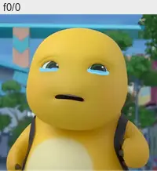

- **Veredicto:** retocar (confianza alta) · estático · [sticker](../../Stickers%20Nailong/sticker_1.webp)
- **Qué se ve:** Estático. Primer plano al aire libre (árboles y un pilar de rombos de colores) con las correas de una mochila a la espalda; mira hacia arriba con lágrimas acumuladas en los ojos y la boca apretada en una raya.
- **Notas:** No se ve colegio ni comida: «prefiere quedarse en casa comiendo» es inventado. El pilar de colores podría ser la entrada de una escuela, pero no se distingue.
- **Antes:** «Puchero de Colegio» — Con su mochila de la escuela y lagrimitas cómicas porque prefiere quedarse en casa comiendo. *(🤪 Caritas · sonido `duang`)*
- **Ahora:** «Lágrimas con Mochila a Cuestas» — Con la mochila a la espalda, mira hacia arriba con los ojos llenos de lágrimas y la boca apretada, aguantándose el llanto. *(🤪 Caritas · sonido `duang`)*

### #2 · Lengua Fuera y Ojos Locos
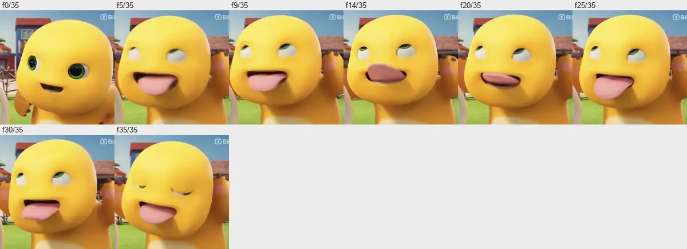

- **Veredicto:** retocar (confianza alta) · 36 fotogramas · 2.4 s · bucle · clave `dragon-de-leche` · [sticker](../../Stickers%20Nailong/sticker_2.webp)
- **Qué se ve:** f0-f2: mira de reojo con media sonrisa pícara y empieza a subir las manos; f3-f34: con las manos junto a la cara, pone los ojos en blanco, saca la lengua y menea la cabeza de lado a lado; f35: cierra los ojos con la lengua fuera. Exterior con césped y casas. Casi bucle.
- **Notas:** Marca de agua de Bilibili arriba a la derecha (recorte de un vídeo). «Del valle» es relleno; falta la mirada pícara del inicio y las manos junto a la cara.
- **Antes:** «Lengua Fuera y Ojos Locos» — Saca la lengua, mueve la cabecita y pone los ojos en blanco: ¡la burla más simpática del valle! *(🤪 Caritas · sonido `bleh`)*
- **Ahora:** «Lengua Fuera y Ojos Locos» — Mira de reojo con picardía, sube las manos junto a la cara y se burla con la lengua fuera, los ojos en blanco y meneando la cabeza. *(🤪 Caritas · sonido `bleh`)*

### #3 · Cara de Incredulidad
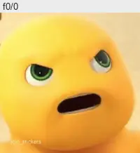

- **Veredicto:** retocar (confianza alta) · estático · [sticker](../../Stickers%20Nailong/sticker_3.webp)
- **Qué se ve:** Estático. Primer plano muy cercano: entorna un ojo, abre el otro mirando hacia arriba y deja la boca abierta en una mueca de incredulidad.
- **Notas:** Marca de agua «jojo_stickers» abajo a la izquierda (sticker de un creador de fans). La tarta y la nevera son inventadas; Nailong no tiene cejas visibles, el gesto es de los ojos.
- **Antes:** «Ceja Sospechosa» — Levantando una ceja dudoso: "¿Seguro que no queda tarta en la nevera?" *(🤪 Caritas · sonido `pop`)*
- **Ahora:** «Cara de Incredulidad» — Entorna un ojo, abre mucho el otro y deja la boca abierta: una mueca de no creerse ni una palabra. *(🤪 Caritas · sonido `surprise`)*

### #4 · Atento junto al Esqueleto
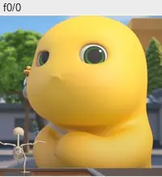

- **Veredicto:** retocar (confianza media) · estático · [sticker](../../Stickers%20Nailong/sticker_4.webp)
- **Qué se ve:** Estático. De perfil hacia la izquierda y con los brazos cruzados, gira los ojos hacia la cámara con gesto serio. En primer plano, sobre una mesa, una pequeña maqueta de esqueleto; detrás de su cabeza asoma un bulto gris con un patito amarillo de juguete encima. Exterior con edificios.
- **Notas:** La categoría «amigos» no se justifica: no se distingue a otro personaje (solo el bulto gris con el patito, imposible de identificar). Propongo «caritas». No uso «Brazos Cruzados» en el título porque ya existe «Brazos Cruzados con Estilo».
- **Segunda opinión a ciegas** (confianza media): En primer plano hay una maqueta de esqueleto sobre una peana; detrás está Nailong (y al fondo árboles, edificio y cielo). Puede que haya otro personaje: a la izquierda, tapado por la cabeza de Nailong, asoma un patito amarillo sobre formas gris-blancas, pero solo se ve un trozo y no se distingue si es otro personaje o un juguete. Gesto: brazos cruzados y mirada de reojo hacia arriba, pensativo o escéptico.
- **Antes:** «Escuchando Atento» — De perfil y con los bracitos cruzados, mirando de reojo muy atento a lo que pasa a su lado. *(👥 Amigos y Rivales · sonido `pop`)*
- **Ahora:** «Atento junto al Esqueleto» — De perfil y con los brazos cruzados, mira de reojo muy serio junto a una pequeña maqueta de esqueleto. *(🤪 Caritas · sonido `pop`)*

### #5 · ¡Grito con Casco de Soldado!
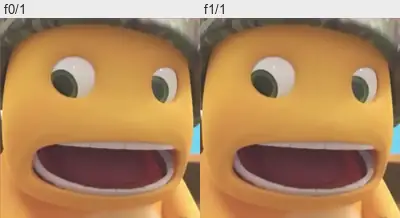

- **Veredicto:** reescribir (confianza alta) · 2 fotogramas · 2.0 s · bucle · clave `casco-soldado` · [sticker](../../Stickers%20Nailong/sticker_5.webp)
- **Qué se ve:** Dos fotogramas idénticos (estático en la práctica). Primer plano con un casco militar de camuflaje; ojos muy abiertos mirando a un lado y la boca abiertísima enseñando los dientes de arriba, como pegando un grito.
- **Notas:** No es una sonrisa ni hay risa: es un grito. El texto actual no menciona el casco de camuflaje. Color más anaranjado de lo normal (quizá filtro o compresión). El EXIF trae el nombre de otro pack («Muñeco amarillo»): viene de un sticker de fans.
- **Antes:** «¡Gran Sonrisa!» — Primer plano con los ojos saltones y la boca abierta de par en par, ¡entre la risa y el asombro! *(🤪 Caritas · sonido `laugh`)*
- **Ahora:** «¡Grito con Casco de Soldado!» — Con un casco militar de camuflaje en la cabeza, abre mucho los ojos y pega un grito enorme enseñando los dientes. *(🤪 Caritas · sonido `surprise`)*

### #6 · Gorro Blanco y Morritos
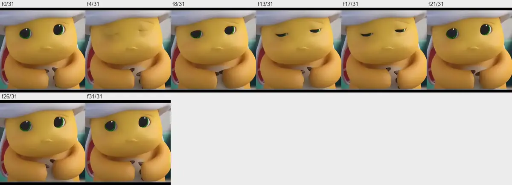

- **Veredicto:** reescribir (confianza media) · 32 fotogramas · 1.1 s · bucle · [sticker](../../Stickers%20Nailong/sticker_6.webp)
- **Qué se ve:** f0: con un gorro blanco de ala ancha y las manos juntas sobre la tripa, pone morritos y mira a cámara con ojos grandes; f3-f7: cierra los ojos despacio y los vuelve a abrir; f13-f17: segundo parpadeo lento; f21-f31: se queda mirando quieto. Bucle. Franjas negras arriba y abajo.
- **Notas:** No hay pastel ni horno: es inventado, y no come nada (propongo «caritas»). El gorro blanco podría ser de cocinero, pero el encuadre lo corta y no se puede asegurar; detrás asoma algo rojo con borde blanco (¿un flotador?). Tras la segunda opinión: el gorro no se ve entero (cocinero o boina, no se sabe) y la cara es más de pena que de inocencia.
- **Segunda opinión a ciegas** (confianza media): En la cabeza lleva un gorro blanco grande y blando que sobresale por los dos lados (parece la parte baja de un gorro de cocinero o una boina blanca ancha); el borde superior del encuadre corta la copa, así que no se puede asegurar el tipo. Detrás, a la izquierda, hay un objeto rojo con borde blanco (no se distingue qué es: respaldo, cojín o algo parecido) y al fondo pared gris y una zona verde azulada. Lo que hace: parpadea despacio dos veces con cara de pena o de sueño, con las manitas juntas delante del pecho en gesto tímido.
- **Antes:** «Chef Pastelero Nailong» — Con su gorro blanco de cocinero y las patitas juntas, parpadea muy serio esperando a que el pastel salga del horno. *(🍗 Comilonas · sonido `pop`)*
- **Ahora:** «Gorro Blanco y Morritos» — Con un gorro blanco y las manos juntas delante del pecho, pone morritos y parpadea despacio dos veces, con cara de pena. *(🤪 Caritas · sonido `pop`)*

### #7 · Mirada de Reojo
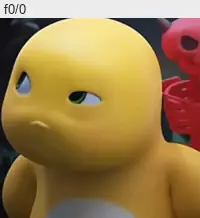

- **Veredicto:** OK (confianza alta) · estático · [sticker](../../Stickers%20Nailong/sticker_7.webp)
- **Qué se ve:** Estático. Primer plano con los ojos entornados mirando de lado hacia la derecha y la boca apretada; detrás, un esqueleto rojo (calavera y costillas) de juguete o decoración, sobre fondo oscuro.
- **Notas:** El texto actual es correcto; solo añado el esqueleto rojo del fondo, que da contexto (parece decoración de Halloween o de feria).
- **Antes:** «Mirada de Reojo» — Mirando de lado con los ojos entornados y cara de pocos amigos: aquí hay algo que no le convence. *(🤪 Caritas · sonido `duang`)*
- **Ahora:** «Mirada de Reojo» — Mira de lado con los ojos entornados y la boca apretada, con un esqueleto rojo detrás: algo no le convence nada. *(🤪 Caritas · sonido `duang`)*

### #8 · ¡Sacadme de Aquí!
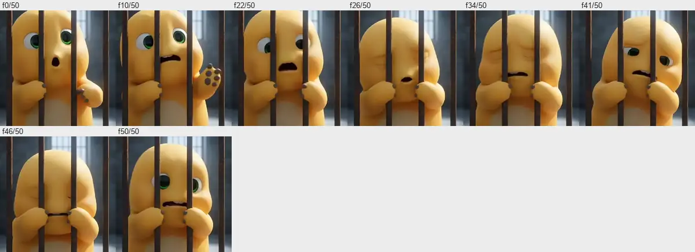

- **Veredicto:** retocar (confianza alta) · 51 fotogramas · 4.2 s · no es bucle · [sticker](../../Stickers%20Nailong/sticker_8.webp)
- **Qué se ve:** f0: agarrado a los barrotes de una celda, pone boca de «oh»; f2-f20: levanta la palma de la otra mano con cara de apuro; f22-f39: se agarra con las dos manos, cierra los ojos y lloriquea; f40-f44: mira a un lado y a otro; f45-f50: pega la cara a los barrotes con cara de preocupación. No es bucle.
- **Notas:** Estilo más realista y cabeza algo distinta a la de la serie: probablemente animación hecha por fans (posible IA). El título usa «Sáquenme» (uso americano); en España, «Sacadme». Faltaba el lloriqueo con los ojos cerrados.
- **Antes:** «¡Sáquenme de Aquí!» — Agarrado a los barrotes: primero se asombra, luego pide ayuda con la patita y al final apoya la cabeza haciendo pucheros. *(🤪 Caritas · sonido `duang`)*
- **Ahora:** «¡Sacadme de Aquí!» — Tras los barrotes, se asombra, levanta la mano pidiendo ayuda, lloriquea con los ojos cerrados y acaba con la cara pegada a la reja. *(🤪 Caritas · sonido `duang`)*

### #9 · Estirándose los Mofletes
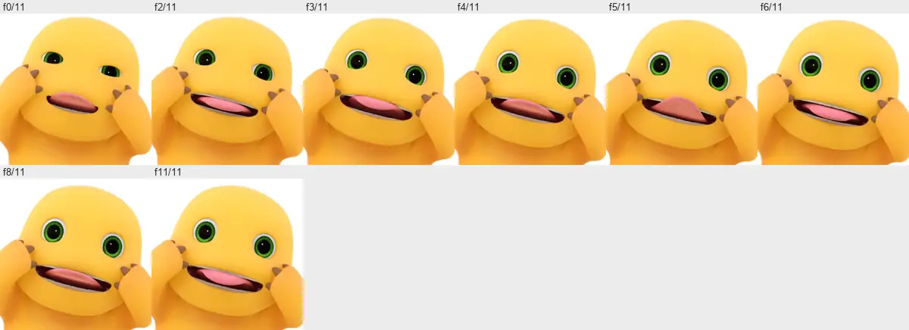

- **Veredicto:** retocar (confianza alta) · 12 fotogramas · 1.0 s · no es bucle · clave `mofletes-estirados` · [sticker](../../Stickers%20Nailong/sticker_9.webp)
- **Qué se ve:** f0-f1: con las dos manos en los mofletes, entorna los ojos y saca la lengua; f2-f11: abre mucho los ojos y tira de los mofletes estirando la boca hacia los lados. Fondo transparente.
- **Notas:** Más que burla es una mueca estirándose la cara; el sonido «duang» (elástico) cuadra con el estirón.
- **Antes:** «Haciendo Burlitas ¡Bleh!» — Sacando la lengua y tocándose los mofletes gorditos en son de broma infantil. *(🤪 Caritas · sonido `pop`)*
- **Ahora:** «Estirándose los Mofletes» — Con las manos en los mofletes, saca la lengua con los ojos entornados y luego tira de la cara para poner una mueca muy estirada. *(🤪 Caritas · sonido `duang`)*

### #10 · Baile Arcoíris con Dos Bolas
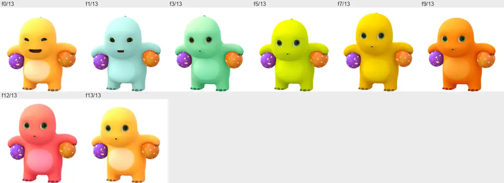

- **Veredicto:** retocar (confianza alta) · 14 fotogramas · 1.1 s · bucle · clave `baile-arcoiris` · [sticker](../../Stickers%20Nailong/sticker_10.webp)
- **Qué se ve:** f0: amarillo anaranjado, sonrisa pícara con los ojos entornados y una bola moteada en cada mano (morada y naranja); f1-f12: el cuerpo cambia de color en cada fotograma (celeste, turquesa, verde menta, lima, amarillo, naranja, coral) mientras bota arriba y abajo con boca de «o»; f13: vuelve al amarillo. Bucle. Fondo transparente.
- **Notas:** Edición de fans evidente (recoloreado que no es de la serie). Las bolas tienen motas blancas (¿maracas o huevos decorados?). El título actual pasa de 32 caracteres.
- **Antes:** «Baile Arcoíris con Bolas de Colores» — Con una bola de colores en cada patita, baila mientras cambia de color como un camaleón: amarillo, verde, naranja... *(💃 Bailes · sonido `maracas`)*
- **Ahora:** «Baile Arcoíris con Dos Bolas» — Edición de fans: con una bola moteada en cada mano, bota sin parar mientras cambia de color (celeste, verde, lima, naranja, rosa...). *(💃 Bailes · sonido `maracas`)*

### #11 · Muñeco Antiestrés Recuperándose
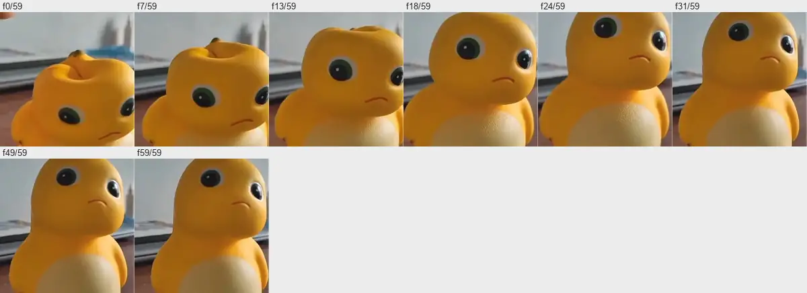

- **Veredicto:** reescribir (confianza alta) · 60 fotogramas · 4.9 s · no es bucle · clave `muneco-antiestres` · [sticker](../../Stickers%20Nailong/sticker_11.webp)
- **Qué se ve:** Vídeo real de un muñeco antiestrés de Nailong sobre una mesa (portátil al fondo). f0: un dedo se aparta y deja la cabeza hundida y aplastada; f7-f31: el muñeco recupera su forma poco a poco; f49-f59: queda entero, mirando hacia arriba con la boca en puchero. No es bucle.
- **Notas:** No es la animación de la serie sino un juguete blandito (tipo squishy) grabado en casa; el texto actual lo cuenta como si el personaje se incorporara. Sonido «duang» (rebote elástico) perfecto.
- **Segunda opinión a ciegas** (confianza alta): Es un muñeco/juguete real (tipo antiestrés blando de recuperación lenta) grabado con el móvil, no una animación. En orden: alguien le aprieta la cabeza con el dedo, la suelta, la cabeza se queda hundida y se va inflando poco a poco hasta volver a su forma, y el muñeco queda con su cara de pena.
- **Antes:** «Morritos Mirando al Cielo» — Se incorpora poco a poco, levanta la cabecita y se queda mirando hacia arriba con la boquita torcida en un puchero. *(🤪 Caritas · sonido `pop`)*
- **Ahora:** «Muñeco Antiestrés Recuperándose» — Un muñeco antiestrés de Nailong con la cabeza aplastada recupera su forma poco a poco y se queda mirando arriba con morritos. *(🤪 Caritas · sonido `duang`)*

### #12 · Cara Enharinada en la Cocina
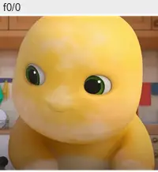

- **Veredicto:** retocar (confianza alta) · estático · [sticker](../../Stickers%20Nailong/sticker_12.webp)
- **Qué se ve:** Estático. En una cocina (armarios de madera, un cuenco metálico al fondo), con la cara manchada de harina blanca, sonríe con la boca cerrada y mira de reojo con picardía.
- **Notas:** No se ve bizcocho ni horno: «después de intentar hornear un bizcocho» es inventado. No come ni bebe nada: propongo «caritas» en vez de «comida».
- **Antes:** «Accidente con la Harina» — Con toda la carita llena de harina blanca después de intentar hornear un bizcocho. *(🍗 Comilonas · sonido `pop`)*
- **Ahora:** «Cara Enharinada en la Cocina» — En la cocina y con la cara manchada de harina, sonríe con la boca cerrada y mira de reojo como quien no ha hecho nada. *(🤪 Caritas · sonido `laugh`)*

### #13 · ¡Bleeeh! Lengua a lo Loco
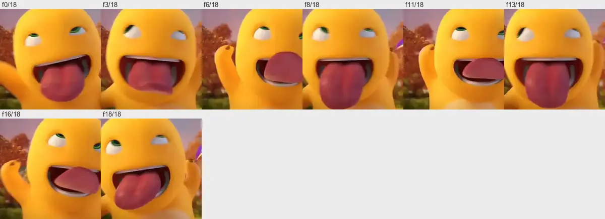

- **Veredicto:** retocar (confianza media) · 19 fotogramas · 1.6 s · bucle · clave `burla-lengua` · [sticker](../../Stickers%20Nailong/sticker_13.webp)
- **Qué se ve:** f0-f18: con las manos en alto junto a la cabeza, pone los ojos en blanco, abre muchísimo la boca y menea la lengua y la cabeza de lado a lado sin parar; fondo otoñal con árboles rojizos. Bucle.
- **Notas:** Más que una carcajada parece una burla alocada (como el #2, pero exagerada); no saluda: agita las manos junto a la cabeza. En el borde derecho asoma algo morado en algún fotograma (no identificable).
- **Segunda opinión a ciegas** (confianza media): Expresa burla o tontería (la típica cara de «bleh»: ojos en blanco y lengua fuera meneándola), no un grito; tampoco parece risa. Las manos están levantadas a los lados de la cabeza y se agitan al ritmo del balanceo; en la mano derecha (borde derecho) parece llevar algo morado que no se distingue.
- **Antes:** «Risas a Carcajadas» — Riendo con la boca abierta, la lengua fuera y los ojos en blanco mientras saluda con la patita. *(🤪 Caritas · sonido `laugh`)*
- **Ahora:** «¡Bleeeh! Lengua a lo Loco» — Con las manos en alto, pone los ojos en blanco, abre una bocaza enorme y menea la lengua y la cabeza de lado a lado sin control. *(🤪 Caritas · sonido `bleh`)*

### #14 · Preocupado en la Tumbona
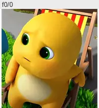

- **Veredicto:** retocar (confianza media) · estático · [sticker](../../Stickers%20Nailong/sticker_14.webp)
- **Qué se ve:** Estático. Delante de una tumbona de rayas rojas y amarillas, sobre el césped, ladea la cabeza y mira hacia arriba, a un lado, con cara de preocupación y mofletes sonrosados. En el borde izquierdo asoma algo azul y redondeado.
- **Notas:** El bulto azul de la izquierda podría ser otro personaje (¿Bombloong?) cortado por el encuadre; no se puede confirmar. No está claro si está sentado en la tumbona o de pie delante; el gesto es más de preocupación que de «pedir un favor». Tras la segunda opinión: está sentado en la tumbona. El bulto azul del borde no se puede identificar: no se nombra.
- **Segunda opinión a ciegas** (confianza media): En el borde izquierdo asoma una forma redondeada azul petróleo oscura, cortada por el encuadre (podría ser parte de otro personaje o un objeto; no se distingue). En el borde derecho solo está el armazón de madera de la tumbona. Está sentado. Expresa preocupación o inquietud (cara de «ay, ¿y ahora qué?»).
- **Antes:** «Ojitos Tiernos junto a la Tumbona» — De pie junto a la tumbona de rayas, ladea la cabeza con ojitos tiernos como pidiendo un favor. *(🤪 Caritas · sonido `duang`)*
- **Ahora:** «Preocupado en la Tumbona» — Sentado en una tumbona de rayas rojas y amarillas, ladea la cabeza y mira hacia arriba con cara de preocupación y los mofletes colorados. *(🤪 Caritas · sonido `duang`)*

### #15 · Siesta con la Lengua Fuera
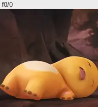

- **Veredicto:** OK (confianza alta) · estático · [sticker](../../Stickers%20Nailong/sticker_15.webp)
- **Qué se ve:** Estático. Tumbado de lado sobre un suelo de roca, en lo que parece una cueva, con los ojos cerrados, una sonrisa y la lengua asomando por la comisura.
- **Notas:** El texto actual describe bien la escena; lo retoco levemente para mencionar las rocas.
- **Antes:** «Siesta con la Lengua Fuera» — Tumbado en el suelo como un flan derretido, dormido del todo y con la lengüita asomando. *(🤪 Caritas · sonido `sleep`)*
- **Ahora:** «Siesta con la Lengua Fuera» — Tumbado de lado sobre las rocas, duerme a pierna suelta con una sonrisa y la lengua asomando: frito del todo. *(🤪 Caritas · sonido `sleep`)*

### #16 · Hecho Polvo
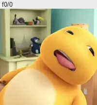

- **Veredicto:** retocar (confianza alta) · estático · [sticker](../../Stickers%20Nailong/sticker_16.webp)
- **Qué se ve:** Estático. En una habitación (estantería con un osito azul y figuras de pájaros), echa la cabeza hacia atrás con los ojos entornados y la boca abierta, con la lengua colgando.
- **Notas:** No se ve comida: «barriga llena» y «coma dulce» son inventados. Propongo «caritas». El gesto es de agotamiento o de «no puedo más».
- **Antes:** «Empacho Feliz» — Echado hacia atrás con la barriga llena, la boca abierta y la lengua fuera, en pleno coma dulce. *(🍗 Comilonas · sonido `duang`)*
- **Ahora:** «Hecho Polvo» — En una habitación llena de juguetes, echa la cabeza hacia atrás con los ojos entornados y la lengua colgando, como si no pudiera más. *(🤪 Caritas · sonido `bleh`)*

### #17 · Palomitas y Risas en el Sofá
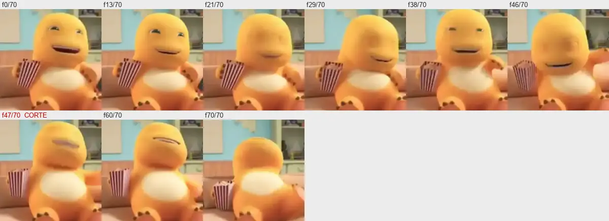

- **Veredicto:** retocar (confianza alta) · 71 fotogramas · 4.7 s · no es bucle · cortes en f47 · clave `palomitas-sofa` · [sticker](../../Stickers%20Nailong/sticker_17.webp)
- **Qué se ve:** f0-f20: sentado en el sofá con una caja de palomitas de rayas bajo el brazo, se ríe con los ojos cerrados; f21-f46: se balancea de un lado a otro riéndose; f47 (corte): plano algo más abierto, echa la cabeza atrás con los ojos apretados de risa; f66-f70: se deja caer hacia atrás en el sofá. No es bucle.
- **Notas:** No llega a comer palomitas: el momento clave es la risa. Propongo «caritas» y sonido «laugh» (no hay mordisco para «chomp»). Al final se echa hacia atrás, no se revuelca. Edición: dejo «comida» porque la caja de palomitas es el tema del sticker (filtro «Comilonas»), aunque no llegue a comer.
- **Antes:** «Palomitas y Risas en el Sofá» — Sentado en el sofá con su caja de palomitas, se ríe tanto que acaba revolcándose de lado a lado. *(🍗 Comilonas · sonido `chomp`)*
- **Ahora:** «Palomitas y Risas en el Sofá» — Sentado en el sofá con su caja de palomitas, se ríe con los ojos cerrados, se balancea y acaba dejándose caer hacia atrás. *(🍗 Comilonas · sonido `laugh`)*

### #18 · Palmas y Meneo en el Jardín
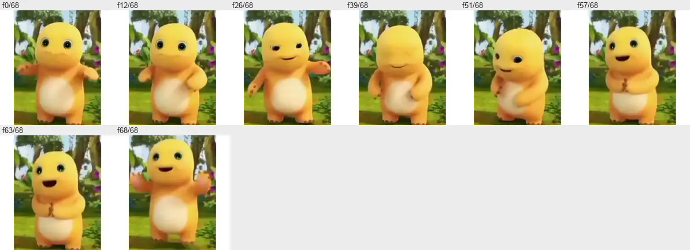

- **Veredicto:** retocar (confianza alta) · 69 fotogramas · 4.6 s · no es bucle · clave `palmas-jardin` · [sticker](../../Stickers%20Nailong/sticker_18.webp)
- **Qué se ve:** Jardín con árboles y flores; franjas blancas a los lados. f0-f22: abre los brazos y junta las manos dando palmas delante del pecho; f23-f25: cierra los ojos; f26-f38: sonríe y repite; f39-f52: se gira de lado y menea el cuerpo y la cola; f53-f68: de frente, abre mucho los brazos con una gran sonrisa de boca abierta.
- **Notas:** Posible animación de fans (estilo algo distinto), no seguro. No salta: «saltarín» y «barriguita que bota como gelatina» sobran.
- **Antes:** «Bailecito Saltarín Duang» — Bailando en el jardín con los bracitos abiertos y una sonrisa, mientras su barriguita bota como gelatina. *(💃 Bailes · sonido `duang`)*
- **Ahora:** «Palmas y Meneo en el Jardín» — Baila en el jardín: da palmas, se gira de lado meneando la cola y vuelve de frente con los brazos abiertos y una gran sonrisa. *(💃 Bailes · sonido `maracas`)*

### #19 · ¡Uoooh! ¡Qué Ilusión!
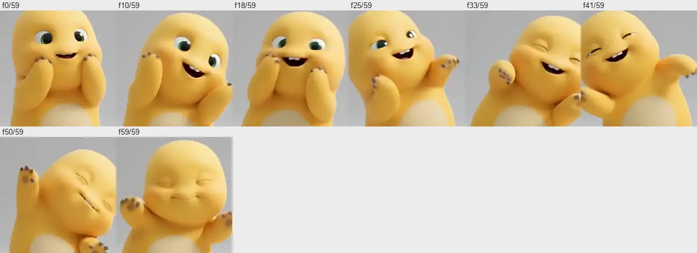

- **Veredicto:** retocar (confianza alta) · 60 fotogramas · 4.9 s · bucle · clave `ilusion` · [sticker](../../Stickers%20Nailong/sticker_19.webp)
- **Qué se ve:** Fondo gris liso. f0-f21: con las manos en los mofletes, sonríe ilusionado y mueve la cabeza a los lados; f22-f45: sube y baja los brazos alternándolos y se balancea, ya riendo con los ojos cerrados; f46-f59: sigue meciéndose con una sonrisa tranquila y los ojos cerrados. Casi bucle.
- **Notas:** Render de estudio, posiblemente animación de fans (IA). Faltaba el bailecito de brazos de la segunda mitad.
- **Antes:** «¡Uoooh! ¡Qué Ilusión!» — Se lleva las patitas a los mofletes ilusionado y acaba riéndose con los ojos cerrados de pura emoción. *(🤪 Caritas · sonido `fanfare`)*
- **Ahora:** «¡Uoooh! ¡Qué Ilusión!» — Se lleva las manos a los mofletes muy ilusionado y luego se balancea agitando los brazos, riendo con los ojos cerrados. *(🤪 Caritas · sonido `fanfare`)*

### #20 · Comiéndose las Uñas
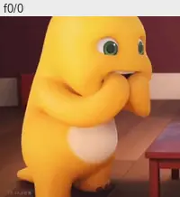

- **Veredicto:** retocar (confianza alta) · estático · [sticker](../../Stickers%20Nailong/sticker_20.webp)
- **Qué se ve:** Estático. De pie en una sala con suelo de madera, junto a una mesita roja, se lleva las dos manos a la boca (asoman los dientes) y mira a un lado con los ojos muy abiertos y cara de nervios.
- **Subtítulos:** Abajo a la izquierda: «2人正在看» = «2 personas lo están viendo» (contador de espectadores de una app de vídeo; no es diálogo).
- **Notas:** «Se le ha escapado algo» es inventado; parece morderse las manos de nervios.
- **Antes:** «¡Ups! Patitas en la Boca» — De pie con las dos patitas tapándose la boca y los ojos muy abiertos: ¡se le ha escapado algo! *(🤪 Caritas · sonido `duang`)*
- **Ahora:** «Comiéndose las Uñas» — De pie junto a una mesita roja, se lleva las manos a la boca y mira a un lado con los ojos muy abiertos, comido por los nervios. *(🤪 Caritas · sonido `surprise`)*

### #21 · ¡A Correr! ¡Sálvese Quien Pueda!
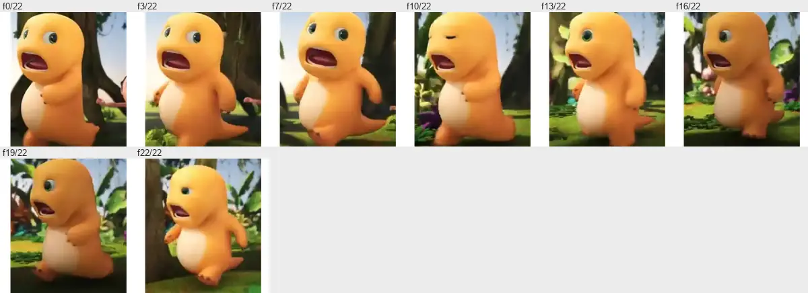

- **Veredicto:** retocar (confianza alta) · 23 fotogramas · 1.5 s · no es bucle · clave `huida-bosque` · [sticker](../../Stickers%20Nailong/sticker_21.webp)
- **Qué se ve:** f0-f2: en un bosque, una mano rosa asoma por la derecha hacia él y arranca a correr con la boca muy abierta y ojos de susto; f3-f22: la cámara lo sigue mientras corre entre árboles, plantas y setas, gritando con la boca abierta. No es bucle.
- **Notas:** La mano rosa del principio es de otro personaje fuera de plano (no identificable); explica el «¡sálvese quien pueda!».
- **Antes:** «¡A Correr! ¡Sálvese Quien Pueda!» — Corriendo por el bosque con la boca abierta de puro susto y las patitas a toda velocidad. *(💃 Bailes · sonido `run`)*
- **Ahora:** «¡A Correr! ¡Sálvese Quien Pueda!» — Una mano rosa asoma a su lado y sale corriendo por el bosque con la boca abierta de susto, moviendo brazos y piernas a toda prisa. *(💃 Bailes · sonido `run`)*

### #22 · ¡Bah! Paso de Todo
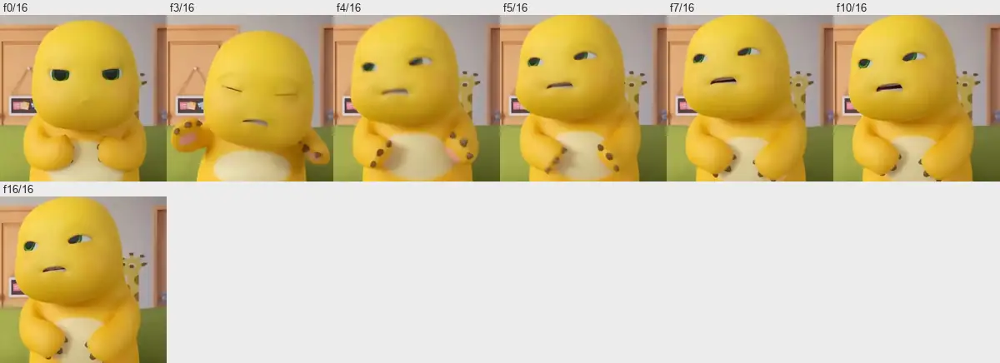

- **Veredicto:** reescribir (confianza media) · 17 fotogramas · 1.4 s · no es bucle · [sticker](../../Stickers%20Nailong/sticker_22.webp)
- **Qué se ve:** f0-1: de pie en un cuarto (puertas, jirafa de juguete, sofá verde), mira serio a cámara con los párpados caídos y las manos en el pecho. f2-3: cierra los ojos, ladea la cabeza y sacude las manos hacia fuera con desdén. f4-16: vuelve a juntar las manos en la tripa y desvía la mirada hacia arriba, a un lado, con una mueca de fastidio. No es bucle.
- **Notas:** No niega con la cabeza ni parece enfadado: es un gesto de desdén o de pasar del tema.
- **Segunda opinión a ciegas** (confianza alta): Expresa desdén o fastidio: primero un «bah» con los ojos cerrados y los brazos abiertos (palmas hacia fuera, como quitándose de encima el asunto) y luego una mirada de reojo despectiva con la boca torcida. La cabeza se inclina hacia un lado y se queda ladeada; las manos pasan del pecho a abrirse hacia fuera y vuelven juntas sobre la barriga.
- **Antes:** «Enfadado Diciendo que No» — Con el ceño fruncido, niega con la cabeza y con las patitas: "¡Que no, que no y que no!". *(🤪 Caritas · sonido `duang`)*
- **Ahora:** «¡Bah! Paso de Todo» — Mira serio, cierra los ojos y sacude las manos con desdén; luego desvía la mirada hacia arriba con una mueca de fastidio. *(🤪 Caritas · sonido `bleh`)*

### #23 · Bailoteo Sentado en el Suelo
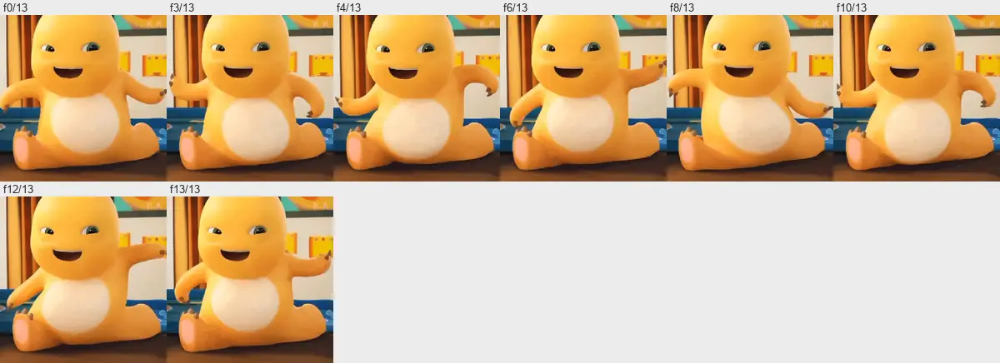

- **Veredicto:** reescribir (confianza media) · 14 fotogramas · 1.2 s · bucle · [sticker](../../Stickers%20Nailong/sticker_23.webp)
- **Qué se ve:** f0-13: sentado en el suelo con las piernas estiradas, balancea los brazos alternándolos adelante y atrás mientras mira de reojo con una sonrisa pícara. Bucle. No saluda.
- **Notas:** Marca «K.K» arriba a la derecha y tono muy anaranjado: posible edición de fans.
- **Segunda opinión a ciegas** (confianza alta): Mueve los brazos arriba y abajo alternándolos, en vaivén, como bailando sentado. No parece un saludo: no abre la mano hacia nadie ni hay otro personaje en plano; es un bailoteo contento con mirada pícara de reojo.
- **Antes:** «¡Hola a Todos con las Patitas!» — Sentado en el suelo saludando con las dos patitas con gran entusiasmo. *(💃 Bailes · sonido `laugh`)*
- **Ahora:** «Bailoteo Sentado en el Suelo» — Sentado en el suelo con las piernas estiradas, balancea los brazos adelante y atrás mientras mira de reojo con sonrisa pícara. *(💃 Bailes · sonido `maracas`)*

### #24 · Coreografía en el Prado
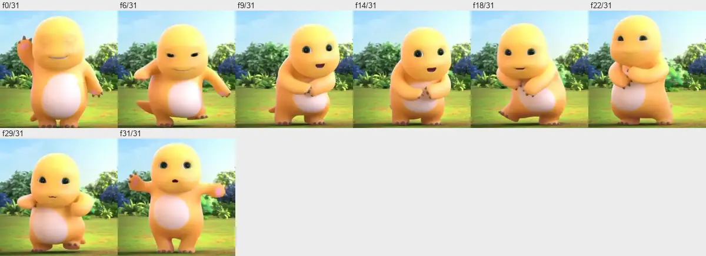

- **Veredicto:** retocar (confianza alta) · 32 fotogramas · 2.6 s · no es bucle · [sticker](../../Stickers%20Nailong/sticker_24.webp)
- **Qué se ve:** f0-4: en un prado con arbustos, saluda con una mano en alto y los ojos cerrados sonrientes. f5-7: se gira de lado dando pasos. f8-18: se frota las manos a la altura del pecho mientras se balancea. f19-28: cruza los brazos sobre el pecho con timidez. f29-31: abre los brazos con la boca en forma de o. No es bucle.
- **Notas:** No se frota la tripa, sino las manos.
- **Antes:** «Bailecito en el Prado» — Saluda con la patita, se frota la barriguita y abre los brazos: todo un bailecito sobre el prado verde. *(💃 Bailes · sonido `duang`)*
- **Ahora:** «Coreografía en el Prado» — Saluda con una mano, se da la vuelta, se frota las manos, cruza los brazos con timidez y termina abriéndolos con cara de asombro. *(💃 Bailes · sonido `duang`)*

### #25 · Meneo Sabrosón de Hombros
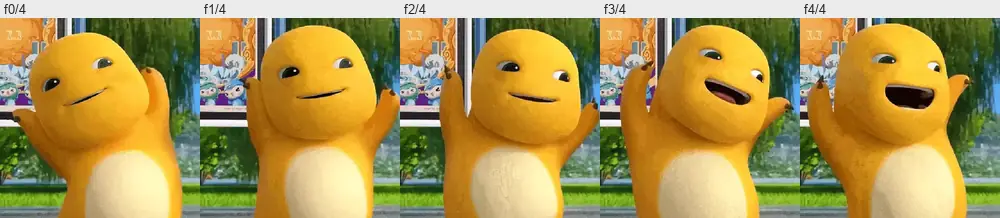

- **Veredicto:** retocar (confianza alta) · 5 fotogramas · 0.4 s · bucle · [sticker](../../Stickers%20Nailong/sticker_25.webp)
- **Qué se ve:** f0-4: con los dos brazos en alto delante de un cartel, se balancea de lado a lado; la sonrisa ladeada se abre en una risa con la boca muy abierta. Bucle corto (5 fotogramas).
- **Notas:** Solo se ve medio cuerpo: no se aprecian las caderas.
- **Antes:** «Meneo de Caderas Sabrosón» — Bailando con las patitas arriba y meneando la pancita con mucho ritmo. *(💃 Bailes · sonido `maracas`)*
- **Ahora:** «Meneo Sabrosón de Hombros» — Con los brazos en alto, se menea de lado a lado y su sonrisa pícara se convierte en una risa con la boca bien abierta. *(💃 Bailes · sonido `maracas`)*

### #26 · Ojos Tiernos de Cachorrito
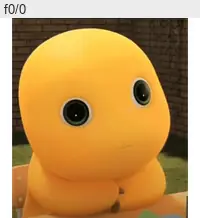

- **Veredicto:** retocar (confianza alta) · estático · [sticker](../../Stickers%20Nailong/sticker_26.webp)
- **Qué se ve:** Estático: con la barbilla apoyada sobre los brazos cruzados encima de una mesa de madera, junto a una pared de ladrillo, mira hacia arriba con los ojos muy abiertos y redondos y la boca pequeña.
- **Notas:** No hay comida ni pollo a la vista: el motivo era inventado.
- **Antes:** «Ojos Tiernos de Cachorrito» — Apoyando la barbilla en la mesa pidiendo otro trozo de pollo con ojos irresistibles. *(🤪 Caritas · sonido `duang`)*
- **Ahora:** «Ojos Tiernos de Cachorrito» — Con la barbilla apoyada sobre los brazos encima de una mesa, levanta la mirada con unos ojos enormes y redondos. *(🤪 Caritas · sonido `duang`)*

### #27 · Nailong Teñido de Morado
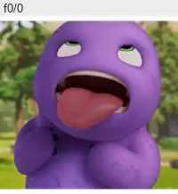

- **Veredicto:** personaje equivocado (confianza media) · estático · [sticker](../../Stickers%20Nailong/sticker_27.webp)
- **Qué se ve:** Estático: un Nailong de color morado, con los ojos en blanco (los iris verdes asoman arriba), la boca muy abierta y la lengua fuera, con las manos bajo la barbilla; fondo de parque.
- **Notas:** No es Bombloong (dragón azul con medio cascarón). Tiene la misma forma, ojos verdes y textura que Nailong: recoloreado de fans o uno de los soldaditos morados de la serie. Ojo: la clave 'bombloong' de este cromo la usa la tarjeta «Bombloong» de «¿Quién es Nailong?» (index.html y su copia mini), que por tanto muestra a este Nailong morado; convendría apuntarla al #117. Si se confirma que es un recoloreado, la categoría sería 'caritas'. Edición: se presenta como edición de fans, como decidió el plan. Deja de ser la imagen de Bombloong (pasa al #117) y sale de «amigos».
- **Lore:** Plan T2 (web oficial): Bombloong es azul, con cascarón; el #27 es Nailong recoloreado (edición de fans).
- **Segunda opinión a ciegas** (confianza media): Es Nailong recoloreado de morado, no un personaje distinto: tiene exactamente la misma forma de cuerpo y cabeza, los mismos ojos verdes y la misma cara de lengua fuera; solo cambia el color del cuerpo (incluida la zona del pecho, que en Nailong es blanca), mientras la lengua, los ojos y el fondo conservan sus colores normales.
- **Antes:** «Bombloong el Rival» — El dragón morado cascarrabias sacando la lengua con cara de pillo. *(👥 Amigos y Rivales · sonido `duang`)*
- **Ahora:** «Nailong Teñido de Morado» — Edición de fans: un Nailong teñido de morado pone los ojos en blanco y saca toda la lengua con las manos bajo la barbilla. *(🤪 Caritas · sonido `bleh`)*

### #28 · Zarandeo a un Nailong Grogui
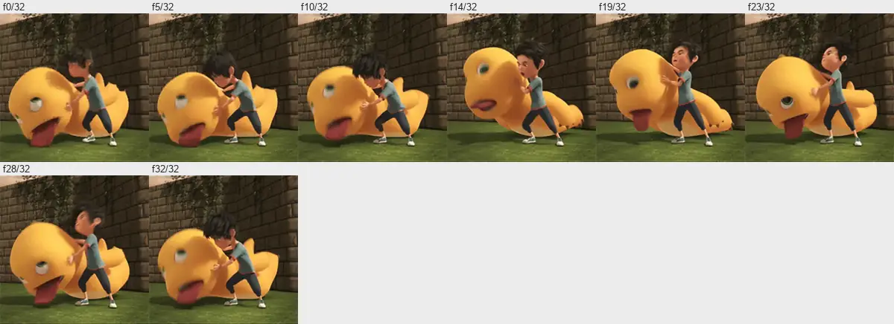

- **Veredicto:** retocar (confianza alta) · 33 fotogramas · 2.0 s · bucle · clave `xiao-qi-colita` · [sticker](../../Stickers%20Nailong/sticker_28.webp)
- **Qué se ve:** f0-32: junto a un muro de ladrillo, Nailong yace flácido en el césped con la lengua fuera y la mirada perdida; un niño de pelo oscuro y camiseta verde azulada lo agarra por el cuello y el pecho y lo zarandea con esfuerzo; la cabeza de Nailong se bambolea. Bucle.
- **Notas:** El niño es probablemente Xiao Qi (el niño de la serie, como en #118 y #121). No lo empuja ni le tira de la cola: lo sacude. La clave 'xiao-qi-colita' y el alt de la tarjeta («Xiao Qi tirando de Nailong») no encajan del todo con la escena.
- **Antes:** «Xiao Qi y el Nailong Perezoso» — Xiao Qi empuja con todas sus fuerzas a un Nailong tirado en el suelo con la lengua fuera, que no piensa moverse. *(👥 Amigos y Rivales · sonido `duang`)*
- **Ahora:** «Zarandeo a un Nailong Grogui» — Un niño agarra a Nailong, tirado en el césped con la lengua fuera y la mirada perdida, y lo zarandea sin que reaccione. *(👥 Amigos y Rivales · sonido `duang`)*

### #29 · Pataleo Bocarriba en el Parque
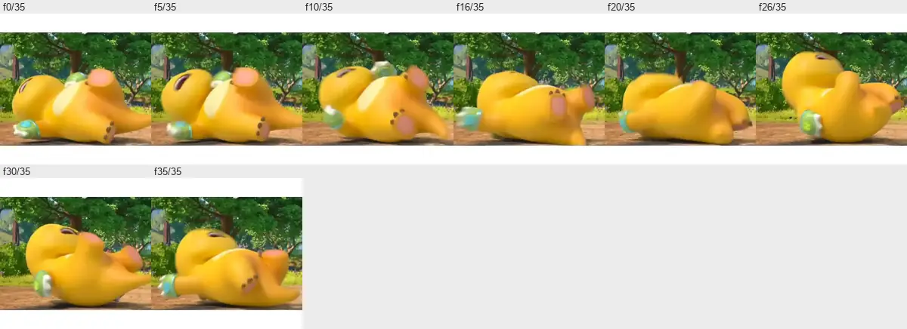

- **Veredicto:** retocar (confianza media) · 36 fotogramas · 3.0 s · bucle · clave `pataleo-camino` · [sticker](../../Stickers%20Nailong/sticker_29.webp)
- **Qué se ve:** Formato apaisado con franjas blancas. f0-35: tumbado bocarriba en un camino de tierra de un parque con árboles, con un objeto verde de tapa blanca en cada mano (parecen botes), se balancea de lado a lado pataleando y abriendo la boca. Bucle. No da vueltas completas ni está en el césped.
- **Notas:** Los objetos verdes no son nítidos (botes o vasos). No se distingue bien si es una pataleta o una risa; por eso no la nombro. Tras la segunda opinión: lo que lleva en las manos no se distingue (¿botes, zapatillas?): «algo verde».
- **Segunda opinión a ciegas** (confianza media): Se revuelca boca arriba de lado a lado y patalea con las piernas en alto, con los ojos cerrados y la boca abierta como si llorara o berreara: parece una pataleta. En las manos lleva algo verde con una parte blanca y un logotipo verde lima (parecen zapatillas deportivas verdes o un juguete; no se distingue bien por el desenfoque de movimiento). Está en un camino de tierra de un parque con árboles.
- **Antes:** «Haciendo la Croqueta en el Césped» — Rodando feliz de lado a lado por el prado verde jugando al solecito. *(💃 Bailes · sonido `laugh`)*
- **Ahora:** «Pataleo Bocarriba en el Parque» — Tumbado bocarriba en un camino de tierra, con algo verde en cada mano, se revuelca de lado a lado pataleando con la boca abierta. *(💃 Bailes · sonido `run`)*

### #30 · Lata Verde y Mucha Espuma
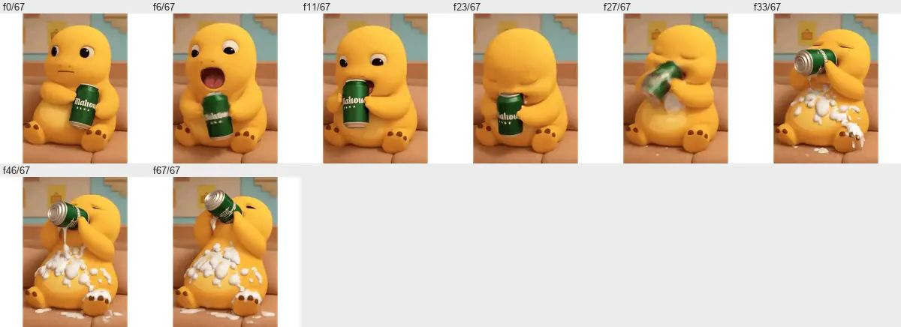

- **Veredicto:** retocar (confianza alta) · 68 fotogramas · 4.4 s · no es bucle · [sticker](../../Stickers%20Nailong/sticker_30.webp)
- **Qué se ve:** f0-4: sentado en un sofá con una lata verde en las manos, mira y parpadea. f5-9: abre mucho la boca. f10-25: se lleva la lata a la boca y cierra los ojos. f26-67: la vuelca de golpe y bebe con la lata bocabajo; la espuma blanca le cae por toda la tripa y el sofá. No es bucle.
- **Notas:** La lata lleva el logotipo «Mahou» con cuatro estrellas: es una cerveza española real, así que es una edición de fans (estilo de animación distinto y franjas blancas laterales). El texto actual dice 'refresco', que no es cierto; propongo 'lata verde' sin marca. Conviene que el usuario decida si este sticker encaja en una web para niños y familias.
- **Antes:** «Lata de Refresco y Mucha Espuma» — Sentado en el sofá con su lata verde: bebe con tantas ganas que acaba con toda la espuma derramada por la barriguita. *(🍗 Comilonas · sonido `slurp`)*
- **Ahora:** «Lata Verde y Mucha Espuma» — Sentado en el sofá con una lata verde, abre mucho la boca, se la acerca y la vuelca de golpe: la espuma le cae por toda la tripa. *(🍗 Comilonas · sonido `slurp`)*

### #31 · Escamas y Cadena de Oro
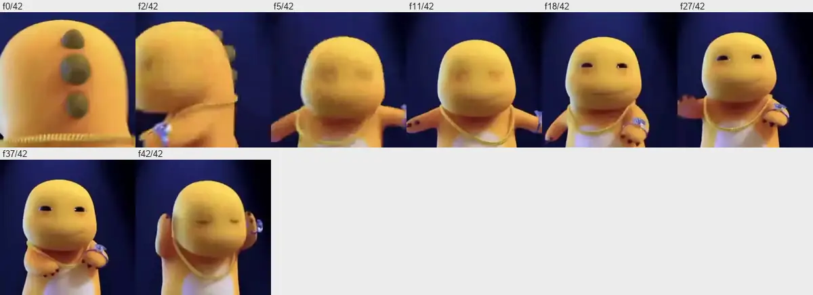

- **Veredicto:** retocar (confianza alta) · 43 fotogramas · 2.8 s · no es bucle · clave `escamitas-espalda` · [sticker](../../Stickers%20Nailong/sticker_31.webp)
- **Qué se ve:** f0: de espaldas, se ven tres escamas verde grisáceo en la nuca y una cadena dorada. f2-4: se gira rápido. f5-13: de frente con los brazos abiertos, cadena de oro al cuello y un anillo de piedra azul. f14-37: ojos entornados y media sonrisa chulesca, mueve los brazos al ritmo. f38-42: se lleva las manos a los lados de la cabeza. Fondo azul oscuro con foco. No es bucle.
- **Notas:** No sale ningún otro personaje: 'amigos' no encaja, paso a 'bailes'. Cadena y anillo: posible montaje de fans (no comprobado). La clave 'escamitas-espalda' sigue siendo válida (f0 muestra las escamas).
- **Antes:** «Las Tres Escamitas de la Espalda» — Empieza enseñando sus tres placas verdes de la espalda y se gira para bailar con su collar dorado bajo los focos. *(👥 Amigos y Rivales · sonido `pop`)*
- **Ahora:** «Escamas y Cadena de Oro» — De espaldas enseña sus tres escamas, se gira luciendo cadena de oro y anillo azul, y baila con aire chulito bajo el foco. *(💃 Bailes · sonido `fanfare`)*

### #32 · Mirada de Indignación
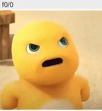

- **Veredicto:** retocar (confianza alta) · estático · [sticker](../../Stickers%20Nailong/sticker_32.webp)
- **Qué se ve:** Estático: primer plano con el ceño fruncido, los ojos mirando de reojo hacia arriba y la boca abierta en gesto de indignación; fondo arenoso con un poste de madera.
- **Notas:** La expresión ofendida es correcta, pero el diálogo sobre el pollo era inventado y 'Gasp' es inglés.
- **Antes:** «Gasp Ofendido» — "¿Cómo que se ha acabado el pollo? ¡Eso es completamente inaceptable!". *(🤪 Caritas · sonido `duang`)*
- **Ahora:** «Mirada de Indignación» — Con el ceño fruncido y la boca abierta, lanza una mirada de reojo hacia arriba, ofendidísimo. *(🤪 Caritas · sonido `surprise`)*

### #33 · Baile con Gorro de León
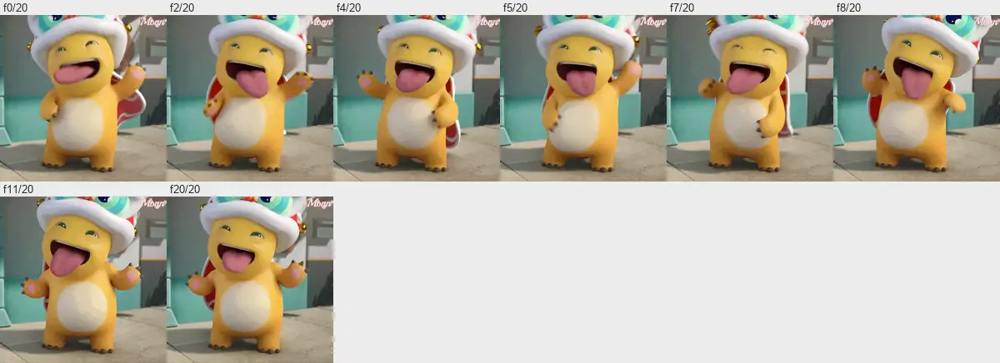

- **Veredicto:** OK (confianza alta) · 21 fotogramas · 2.1 s · no es bucle · clave `gorro-de-leon` · [sticker](../../Stickers%20Nailong/sticker_33.webp)
- **Qué se ve:** f0-7: con una cabeza blanca y peluda de la danza del león (ojos turquesa, tela roja a la espalda), la lengua fuera y los ojos entornados, agita un brazo y luego el otro. f8-20: abre los dos brazos y se balancea. No es bucle.
- **Notas:** Marca de agua rosa «Monn» con corazón arriba a la derecha: edición de fans. Solo quito la fórmula «¡pura fiesta!».
- **Antes:** «Baile con Gorro de León» — Bailando con la lengua fuera y un gorro blanco y peludo de la danza del león, ¡pura fiesta! *(💃 Bailes · sonido `fanfare`)*
- **Ahora:** «Baile con Gorro de León» — Con una cabeza peluda de la danza del león puesta y la lengua fuera, agita los brazos de un lado a otro y acaba abriéndolos. *(💃 Bailes · sonido `fanfare`)*

### #34 · Mirada Esmeralda en la Tumbona
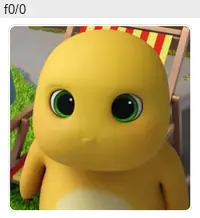

- **Veredicto:** retocar (confianza alta) · estático · [sticker](../../Stickers%20Nailong/sticker_34.webp)
- **Qué se ve:** Estático: primer plano sentado en una tumbona de rayas rojas y amarillas sobre el césped, junto a un camino; mira fijamente con grandes ojos verdes y la boca pequeña. Borde blanco redondeado.
- **Notas:** No hay playa ni cielo azul. El borde blanco es un recorte tipo sticker hecho por fans. No es un baile: paso a 'caritas'.
- **Antes:** «Mirada Esmeralda en la Playa» — Retrato de relax veraniego en la tumbona con cielo azul y brisa fresca. *(💃 Bailes · sonido `duang`)*
- **Ahora:** «Mirada Esmeralda en la Tumbona» — Sentado en una tumbona de rayas rojas y amarillas sobre el césped, mira fijamente con sus enormes ojos verdes. *(🤪 Caritas · sonido `pop`)*

### #35 · Sonrisa Tímida con Colorete
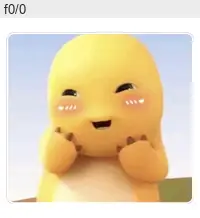

- **Veredicto:** retocar (confianza alta) · estático · [sticker](../../Stickers%20Nailong/sticker_35.webp)
- **Qué se ve:** Estático: con las manos en los mofletes, sonríe con los ojos entornados en forma de media luna; colorete rosa con rayitas y corazones dibujados. Fondo de cielo. Borde blanco.
- **Notas:** El colorete con corazones está dibujado encima (edición de fans). Los ojos no están cerrados. Evito «felicidad pura».
- **Antes:** «Sonrisa Kawaii Mofletuda» — Carita tierna con ojos cerrados y colorete rosa de felicidad pura. *(🤪 Caritas · sonido `laugh`)*
- **Ahora:** «Sonrisa Tímida con Colorete» — Se sujeta los mofletes con las manos y sonríe con los ojos entornados, con colorete rosa y corazones dibujados en la cara. *(🤪 Caritas · sonido `laugh`)*

### #36 · ¿Qué Estará Tramando?
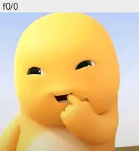

- **Veredicto:** retocar (confianza alta) · estático · [sticker](../../Stickers%20Nailong/sticker_36.webp)
- **Qué se ve:** Estático: se lleva un dedo a la comisura de la boca entreabierta y mira de reojo con media sonrisa pícara; fondo de cielo.
- **Notas:** No hay menú, pasteles ni pollo: era inventado. Evito repetir «Ojito Pillín y Manita en la Boca» (otro título).
- **Antes:** «Mmm... ¿Qué Comemos Hoy?» — Con el dedito en la boca y los ojos entornados, pensando en un menú delicioso lleno de pasteles y pollo. *(🤪 Caritas · sonido `pop`)*
- **Ahora:** «¿Qué Estará Tramando?» — Se lleva un dedo a la comisura de los labios y mira de reojo con media sonrisa, como quien prepara una travesura. *(🤪 Caritas · sonido `laugh`)*

### #37 · Boquiabierto en el Bosque
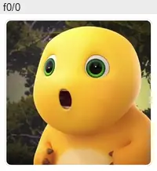

- **Veredicto:** retocar (confianza alta) · estático · [sticker](../../Stickers%20Nailong/sticker_37.webp)
- **Qué se ve:** Estático: primer plano con los ojos verdes muy abiertos, la boca redonda abierta y las manos sobre la tripa; fondo de bosque en penumbra. Borde blanco.
- **Notas:** No hay cohete ni Xiao Qi: era inventado. Borde blanco: recorte tipo sticker de fans. La fanfarria no pega con un susto.
- **Antes:** «Boca Abierta de Fascinación» — Sorprendido al ver volar el nuevo cohete de inventos de Xiao Qi. *(🤪 Caritas · sonido `fanfare`)*
- **Ahora:** «Boquiabierto en el Bosque» — Abre muchísimo los ojos verdes y la boca, plantado en mitad del bosque como si acabara de ver algo increíble. *(🤪 Caritas · sonido `surprise`)*

### #38 · Cóctel en la Hamaca
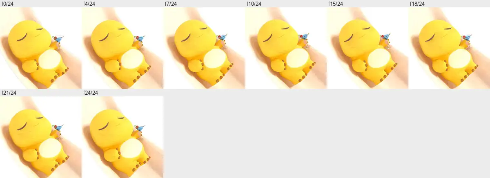

- **Veredicto:** reescribir (confianza alta) · 25 fotogramas · 1.2 s · bucle · clave `siesta-hamaca` · [sticker](../../Stickers%20Nailong/sticker_38.webp)
- **Qué se ve:** f0-24: tumbado en una hamaca de tela clara que se mece, con los ojos cerrados y una sonrisa tranquila, sostiene en una mano una copa de cóctel azul con una cereza. Fondo blanco. Bucle.
- **Notas:** No es una cunita ni hay nubes de nata. Edición: no baila (se mece en la hamaca): paso a «caritas».
- **Antes:** «Dulces Sueños en la Hamaca» — Meciendo su cunita colgante durmiendo como un angelito entre nubes de nata. *(💃 Bailes · sonido `sleep`)*
- **Ahora:** «Cóctel en la Hamaca» — Tumbado en una hamaca que se mece, con los ojos cerrados y una sonrisa tranquila, sostiene un cóctel azul con una cereza. *(🤪 Caritas · sonido `sleep`)*

### #39 · Vueltas y Risas en el Dormitorio
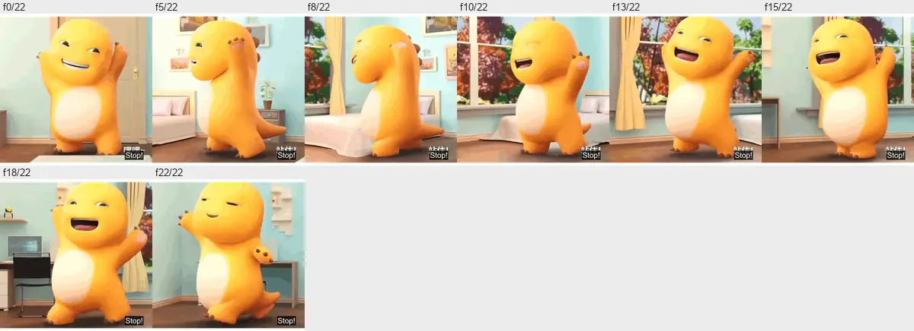

- **Veredicto:** retocar (confianza alta) · 23 fotogramas · 1.5 s · bucle · clave `baile-alegria` · [sticker](../../Stickers%20Nailong/sticker_39.webp)
- **Qué se ve:** f0-1: en un dormitorio, brazos en alto y sonrisa pícara. f2-9: se da la vuelta y queda de espaldas mientras la cámara gira con él (puerta, cama, ventana). f10-18: de frente, suelta una carcajada con los brazos arriba. f19-22: gira hacia el otro lado con los ojos entornados y sigue bailando. Subtítulo fijo abajo a la derecha. No es bucle claro.
- **Subtítulos:** Chino cortado por arriba, probablemente «站住!» (¡Alto! / ¡Quieto!), con «Stop!» en inglés debajo; en f0-1 hay otros caracteres ilegibles.
- **Notas:** Subtítulos bilingües: recorte de un vídeo editado (meme de fans). No hay comida ni recorre la casa: solo su cuarto.
- **Antes:** «¡Baile de Pura Alegría!» — Bailando por toda la casa con los brazos en alto y una sonrisa enorme, celebrando que la comida está lista. *(💃 Bailes · sonido `fanfare`)*
- **Ahora:** «Vueltas y Risas en el Dormitorio» — Con los brazos en alto y sonrisa pícara, da una vuelta completa por su cuarto, suelta una carcajada y sigue bailando tan tranquilo. *(💃 Bailes · sonido `laugh`)*

### #40 · De la Sonrisa a la Carcajada
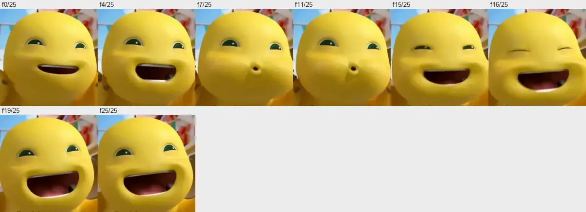

- **Veredicto:** OK (confianza alta) · 26 fotogramas · 1.6 s · no es bucle · [sticker](../../Stickers%20Nailong/sticker_40.webp)
- **Qué se ve:** Primer plano de la cara: f0-5 sonríe y abre y cierra la boca; f6-13 pone morritos en forma de o; f14-25 abre una sonrisa enorme con la boca muy abierta (ojos entornados y luego abiertos). No es bucle.
- **Notas:** Solo cambio «carita gordita» (dos diminutivos) por «cara mofletuda».
- **Antes:** «De la Sonrisa a la Carcajada» — Primer plano de su carita gordita: sonríe, pone morritos y termina soltando una carcajada enorme. *(🤪 Caritas · sonido `laugh`)*
- **Ahora:** «De la Sonrisa a la Carcajada» — Primer plano de su cara mofletuda: sonríe, pone morritos y termina soltando una carcajada enorme. *(🤪 Caritas · sonido `laugh`)*

### #41 · Baile y Vuelta entre Macetas
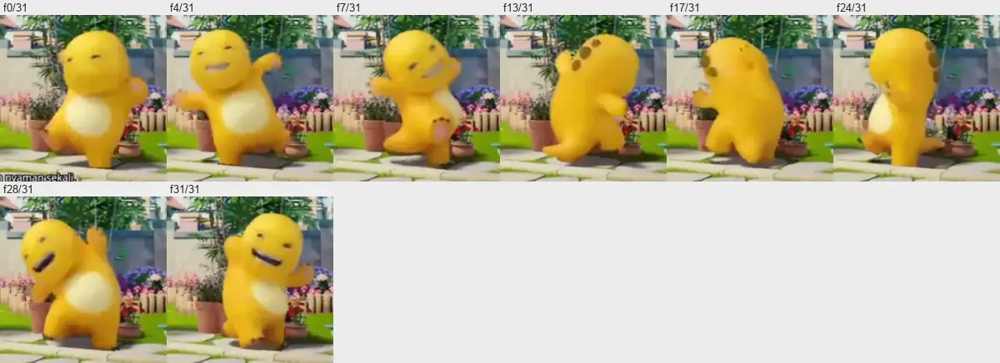

- **Veredicto:** retocar (confianza alta) · 32 fotogramas · 2.0 s · bucle · [sticker](../../Stickers%20Nailong/sticker_41.webp)
- **Qué se ve:** Jardín con macetas de flores y valla de madera. f0-8: baila levantando una pierna y moviendo los brazos, sonriente. f9-24: gira y enseña la espalda (manchas marrones). f25-31: vuelve de frente con una gran sonrisa y levanta otra vez la pierna. Bucle.
- **Subtítulos:** f0-2, abajo a la izquierda, en indonesio (no chino): «…n nyaman sekali.» = «…muy a gusto / muy agradable».
- **Notas:** El subtítulo indonesio indica un clip de fans; de ahí venía el «¡Qué a gusto se está!», pero no se ve el sol. El título actual tiene 33 caracteres (más de 32).
- **Antes:** «¡Mueve el Esqueleto en el Jardín!» — Bailando entre flores y macetas, girando con su barriguita blanca. ¡Qué a gusto se está al solecito! *(💃 Bailes · sonido `duang`)*
- **Ahora:** «Baile y Vuelta entre Macetas» — Baila entre macetas de flores levantando una pierna, da una vuelta entera enseñando la espalda y vuelve de frente muy sonriente. *(💃 Bailes · sonido `tail`)*

### #42 · Asombro con las Manos en Alto
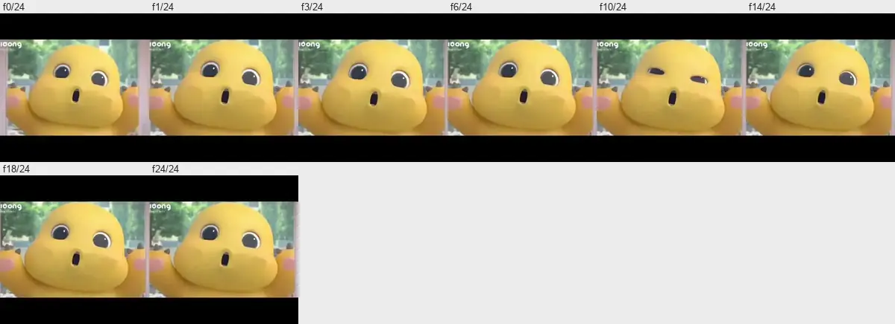

- **Veredicto:** retocar (confianza alta) · 25 fotogramas · 1.6 s · no es bucle · [sticker](../../Stickers%20Nailong/sticker_42.webp)
- **Qué se ve:** Formato apaisado con franjas negras y logotipo «…loong» arriba a la izquierda. f0-24: primer plano con las manos en alto y las palmas rosadas hacia delante, ojos enormes y boca pequeña en forma de o; parpadea (f10-11 y f15-16). Casi estático. Bucle.
- **Notas:** El logotipo parece la marca de agua de un canal. Podría estar pegado a un cristal (cara algo aplastada), no comprobado. «Ojos como Platos» ya existe en otro sticker.
- **Antes:** «Ojitos de Sorpresa Redonda» — Con la boquita en forma de "o" y los bracitos arriba, sin saber muy bien qué ha pasado. *(🤪 Caritas · sonido `pop`)*
- **Ahora:** «Asombro con las Manos en Alto» — Con las manos en alto y las palmas hacia delante, mira con ojos enormes y la boca en forma de o, parpadeando de vez en cuando. *(🤪 Caritas · sonido `pop`)*

### #43 · ¡Brazos Arriba, a Bailar!
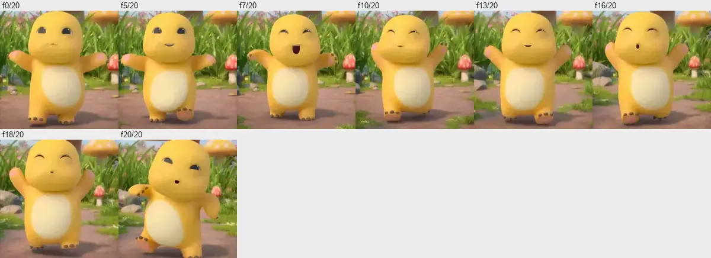

- **Veredicto:** retocar (confianza alta) · 21 fotogramas · 1.3 s · no es bucle · [sticker](../../Stickers%20Nailong/sticker_43.webp)
- **Qué se ve:** f0: de pie en un camino de tierra de un jardín con setas rojas, brazos abiertos y cara seria. f2-f4: sonríe con la boca abierta. f7-f19: cierra los ojos de gusto, sube los brazos y se balancea levantando un pie y luego el otro (f14-f17 boca en «o»). f20: gira el cuerpo de lado con un brazo adelante y ojos entornados. No es bucle.
- **Notas:** Mismo escenario que el #46 (camino de tierra, setas rojas). El texto actual acierta en lo esencial; solo sobran diminutivos.
- **Antes:** «¡Brazos Arriba, a Bailar!» — Con los bracitos abiertos y los ojitos cerrados de felicidad, dando pasitos por el caminito del jardín. *(💃 Bailes · sonido `duang`)*
- **Ahora:** «¡Brazos Arriba, a Bailar!» — En un camino del jardín, abre los brazos, sonríe y cierra los ojos de gusto mientras se balancea dando pasos de baile. *(💃 Bailes · sonido `duang`)*

### #44 · Parpadeo Lento con Desgana
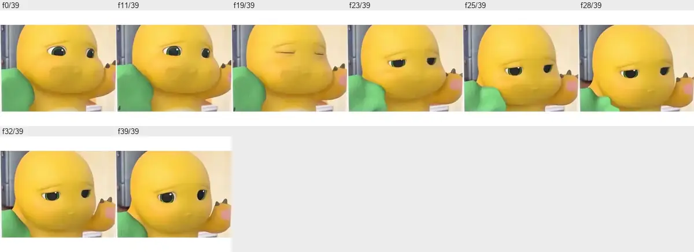

- **Veredicto:** retocar (confianza media) · 40 fotogramas · 2.5 s · no es bucle · [sticker](../../Stickers%20Nailong/sticker_44.webp)
- **Qué se ve:** Primer plano con franjas blancas arriba y abajo. f0-f13: mira de reojo junto a algo verde y mullido (parece un cojín), con una mano levantada junto a la cara. f14-f21: cierra los ojos despacio. f22-f39: los abre a medias, gira la cara hacia la cámara y se queda mirando con los párpados caídos y cara de desgana. No es bucle.
- **Notas:** No se duerme: es un parpadeo lento que acaba en mirada desganada. Las franjas blancas sugieren captura de pantalla o recorte de fans. El objeto verde no se distingue bien (cojín o peluche).
- **Segunda opinión a ciegas** (confianza media): No se duerme del todo: da una cabezada (ojos cerrados en f16-f20) pero se despierta; al final levanta la cabeza de la mano y se queda mirando a cámara con ojos entornados, cansado o fastidiado.
- **Antes:** «Parpadeo Somnoliento» — Apoyado en un cojín verde con los ojitos cada vez más pesados... ¿se habrá dormido ya? *(🤪 Caritas · sonido `sleep`)*
- **Ahora:** «Parpadeo Lento con Desgana» — Junto a un cojín verde, mira de reojo, cierra los ojos despacio y los vuelve a abrir a medias para mirarte con cara de desgana. *(🤪 Caritas · sonido `sleep`)*

### #45 · Carita de Pena Total
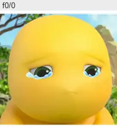

- **Veredicto:** retocar (confianza alta) · estático · [sticker](../../Stickers%20Nailong/sticker_45.webp)
- **Qué se ve:** Estático. Primer plano al aire libre (árbol, rocas, cielo): cejas caídas, ojos verdes llenos de lágrimas azules a punto de caer y boca pequeña y apretada.
- **Notas:** Sobra «pidiendo un abracito» (inventado). No hay sonido triste en la lista; se mantiene duang.
- **Antes:** «Carita de Pena Total» — Con lagrimitas azules en los ojos y cara de pena, pidiendo un abracito bien fuerte. *(🤪 Caritas · sonido `duang`)*
- **Ahora:** «Carita de Pena Total» — Con las cejas caídas y los ojos inundados de lágrimas azules, aguanta el llanto con una cara de pena que parte el corazón. *(🤪 Caritas · sonido `duang`)*

### #46 · ¡Qué Contento en el Jardín!
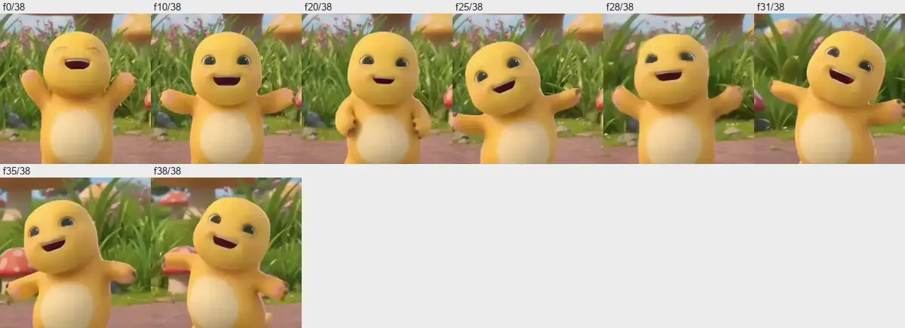

- **Veredicto:** retocar (confianza alta) · 39 fotogramas · 4.9 s · no es bucle · [sticker](../../Stickers%20Nailong/sticker_46.webp)
- **Qué se ve:** Jardín con flores rosas y setas rojas. f0-f1: brazos en alto y ojos cerrados, riendo. f2-f18: abre los ojos y sonríe con la boca abierta y los brazos extendidos. f19-f20: se lleva las manos a la tripa. f21-f23: sube las manos sonriendo con la boca cerrada. f24-f38: se balancea de lado a lado con los brazos abiertos y la boca abierta de alegría (la cámara se mueve). No es bucle.
- **Notas:** No grita: sonríe y ríe. Faltaba el balanceo final, que ocupa la mitad del sticker. Mismo escenario que el #43.
- **Antes:** «¡Gritos de Alegría en el Jardín!» — Levantando los bracitos riendo a carcajadas y luego abrazándose la tripita de puro contento. *(💃 Bailes · sonido `laugh`)*
- **Ahora:** «¡Qué Contento en el Jardín!» — Ríe con los brazos en alto, se lleva las manos a la tripa y acaba balanceándose de lado a lado con los brazos abiertos. *(💃 Bailes · sonido `laugh`)*

### #47 · Ojazos Verdes Enormes
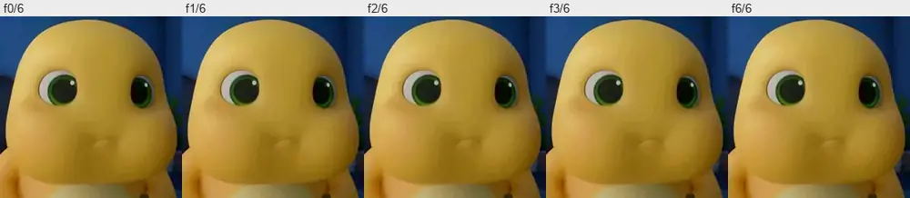

- **Veredicto:** OK (confianza alta) · 7 fotogramas · 0.6 s · bucle · [sticker](../../Stickers%20Nailong/sticker_47.webp)
- **Qué se ve:** Bucle corto (7 fotogramas). Primer plano en una habitación oscura y azulada: mira fijamente a la cámara con grandes ojos verdes; solo se mueven un poco las pupilas y la cabeza.
- **Notas:** Solo sobra el relleno «¡Imposible no sonreír!».
- **Antes:** «Ojazos Verdes Enormes» — Mirando fijamente con sus enormes ojos verdes y su naricita de botón. ¡Imposible no sonreír! *(🤪 Caritas · sonido `duang`)*
- **Ahora:** «Ojazos Verdes Enormes» — En una habitación a oscuras, te mira fijamente con sus enormes ojos verdes, muy quieto y casi sin pestañear. *(🤪 Caritas · sonido `duang`)*

### #48 · Selfi Sonriente
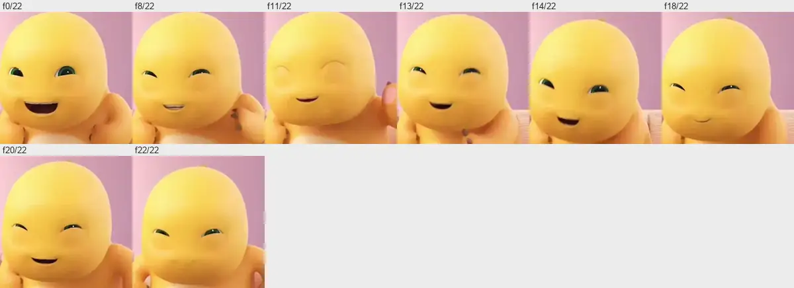

- **Veredicto:** retocar (confianza alta) · 23 fotogramas · 1.4 s · no es bucle · [sticker](../../Stickers%20Nailong/sticker_48.webp)
- **Qué se ve:** Fondo rosa, muy pegado a la cámara. f0-f7: sonrisa con la boca abierta y ojos entornados. f8-f12: cierra los ojos sonriendo y levanta una mano. f13-f17: vuelve la sonrisa abierta ladeando la cabeza. f18-f22: termina con ojos entornados y sonrisa de boca cerrada. No es bucle.
- **Notas:** No se acerca a la cámara: ya está pegado a ella desde el principio. No guiña: cierra los dos ojos.
- **Antes:** «Selfi Sonriente» — Acercándose a la cámara con una sonrisa enorme y guiñando los ojitos de pura felicidad. *(🤪 Caritas · sonido `laugh`)*
- **Ahora:** «Selfi Sonriente» — Pegado a la cámara, sonríe con la boca abierta, cierra los ojos al levantar la mano y termina con una sonrisa traviesa. *(🤪 Caritas · sonido `laugh`)*

### #49 · Camisa Playera y Mal Humor
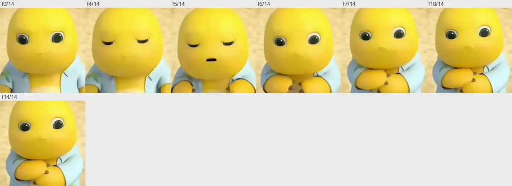

- **Veredicto:** retocar (confianza alta) · 15 fotogramas · 0.9 s · no es bucle · [sticker](../../Stickers%20Nailong/sticker_49.webp)
- **Qué se ve:** Arena de playa de fondo; camisa celeste de manga corta con estampado de hojas. f0-f3: ceño fruncido mirando a la cámara. f4-f5: cierra los ojos y aprieta los labios. f6-f14: se cruza de brazos y se queda mirando enfurruñado. No es bucle.
- **Notas:** Parece la misma camisa que el #125. Sonido tail para el gesto seco de cruzarse de brazos.
- **Antes:** «Camisa Playera y Mal Humor» — Con su camisita celeste de vacaciones y los brazos cruzados, haciéndose el enfadado en la arena. *(🤪 Caritas · sonido `duang`)*
- **Ahora:** «Camisa Playera y Mal Humor» — Con su camisa celeste de playa, frunce el ceño, cierra los ojos apretando los labios y se cruza de brazos, muy enfurruñado. *(🤪 Caritas · sonido `tail`)*

### #50 · Cara de Circunstancias
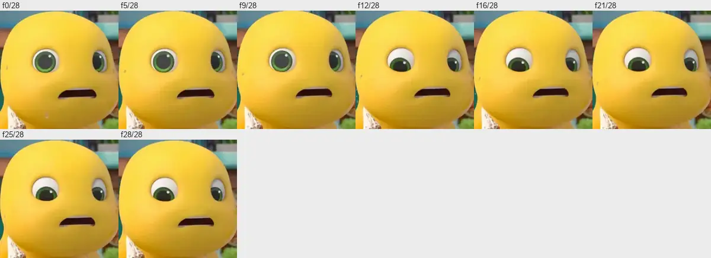

- **Veredicto:** retocar (confianza alta) · 29 fotogramas · 1.8 s · bucle · [sticker](../../Stickers%20Nailong/sticker_50.webp)
- **Qué se ve:** Bucle. Primer plano con fachadas de una calle al fondo y algo blanco con motas abajo a la izquierda. f0-f11: ojos muy abiertos y boca en una mueca tensa. f12-f28: desvía la mirada hacia abajo y a un lado sin cambiar la mueca; hay una gotita junto a la barbilla.
- **Notas:** No hay ninguna cocina: el fondo parece una calle. El objeto blanco con motas no se distingue (¿comida?, ¿papel?); la gotita puede ser sudor. Más que susto, es incomodidad.
- **Antes:** «¡Ay, Qué Susto!» — Con los ojos muy abiertos y la boquita torcida porque ha pasado algo rarísimo en la cocina. *(🤪 Caritas · sonido `pop`)*
- **Ahora:** «Cara de Circunstancias» — Con los ojos muy abiertos y la boca en una mueca tensa, se queda de piedra y luego aparta la mirada sin saber dónde meterse. *(🤪 Caritas · sonido `surprise`)*

### #51 · Pose Chulesca a la Pata Coja

- **Veredicto:** retocar (confianza alta) · 9 fotogramas · 0.9 s · bucle · [sticker](../../Stickers%20Nailong/sticker_51.webp)
- **Qué se ve:** Bucle corto (9 fotogramas). Habitación con zócalo verde azulado y un objeto blanco redondo abajo a la derecha. A la pata coja (una pierna doblada, no estirada), con los brazos abiertos y morritos; mueve los ojos de un lado a otro mirando de reojo.
- **Notas:** Marca de agua tenue en la esquina inferior derecha (posible repost de fans). El título actual casi repite el del #7 («Mirada de Reojo»).
- **Antes:** «Mirada de Reojo con Disimulo» — De pie con una patita estirada y los ojitos mirando de lado, como quien no ha roto nada. *(🤪 Caritas · sonido `pop`)*
- **Ahora:** «Pose Chulesca a la Pata Coja» — A la pata coja y con los brazos abiertos, pone morritos y mira de reojo de un lado a otro con mucha chulería. *(🤪 Caritas · sonido `pop`)*

### #52 · Media Vuelta y a Tus Brazos

- **Veredicto:** retocar (confianza media) · 80 fotogramas · 5.0 s · no es bucle · [sticker](../../Stickers%20Nailong/sticker_52.webp)
- **Qué se ve:** f0-f10: de espaldas (dos escamas verdes en la espalda y cola puntiaguda) en una habitación. f11-f22: se da la vuelta. f23-f40: camina hacia la cámara con una sonrisa. f42-f71: muy cerca, unas manos de persona lo sujetan por los costados; saluda con un brazo y pone la boca en «o»; en f50-f51 se vuelve blanco un instante. f72-f79: sonrisa enorme con la boca abierta. No es bucle.
- **Notas:** La cola es puntiaguda, no «redonda». Las manos son de una persona fuera de plano (no se ve quién). El destello blanco de f50-f51 parece un efecto o montaje de fans. Mantengo «bailes»; podría ser «amigos» si cuentan las manos.
- **Segunda opinión a ciegas** (confianza alta): En orden: está de espaldas, se gira, camina hacia la cámara y acaba en primer plano sonriendo cada vez más hasta una gran sonrisa. Sí interactúa alguien: desde f42 aparecen dos manos humanas (de una persona fuera de plano) que lo agarran por los costados/cintura, como para cogerlo o levantarlo.
- **Antes:** «Se Da la Vuelta... ¡Sorpresa!» — De espaldas enseñando su colita redonda, se gira despacito y sonríe con la barriguita al aire. *(💃 Bailes · sonido `fanfare`)*
- **Ahora:** «Media Vuelta y a Tus Brazos» — De espaldas, se da la vuelta y camina hacia ti; cuando unas manos lo cogen, saluda con el brazo y abre la boca en una gran sonrisa. *(💃 Bailes · sonido `fanfare`)*

### #53 · ¡Adiós desde el Sofá!

- **Veredicto:** retocar (confianza alta) · 33 fotogramas · 2.1 s · no es bucle · [sticker](../../Stickers%20Nailong/sticker_53.webp)
- **Qué se ve:** Salón con ventanal. Recostado en un sofá verde. f0-f15: mano sobre la tripa, mira de reojo con sonrisa de pillo y ojos entornados. f16-f32: levanta el brazo y lo agita para decir adiós con una gran sonrisa abierta. Subtítulo incrustado desde f2. No es bucle.
- **Subtítulos:** «Hm-hm dadah» (no es chino; parece indonesio: «dadah» = «adiós, chao»).
- **Notas:** Subtítulo de fans en indonesio. El gesto final es una despedida, no un saludo. No se rasca: apoya la mano en la tripa.
- **Antes:** «Sentadito en el Sofá» — Repantigado en el sofá verde rascándose la barriguita, hasta que levanta la patita y saluda con una gran sonrisa. *(🤪 Caritas · sonido `pop`)*
- **Ahora:** «¡Adiós desde el Sofá!» — Recostado en el sofá verde con la mano en la tripa, pone cara de pillo y luego levanta el brazo para decir adiós con una gran sonrisa. *(🤪 Caritas · sonido `laugh`)*

### #54 · ¡Mamá, Mamá!

- **Veredicto:** retocar (confianza alta) · 40 fotogramas · 2.5 s · no es bucle · [sticker](../../Stickers%20Nailong/sticker_54.webp)
- **Qué se ve:** Primer plano con mofletes sonrosados y manos juntas bajo la barbilla. f0-f28: mueve la boca hablando mientras mira a un lado y a otro (subtítulo «妈» y luego «妈妈»). f32-f33: cierra los ojos. f34-f39: apoya los mofletes en las manos y sonríe con timidez. No es bucle.
- **Subtítulos:** 妈 / 妈妈 (mā / māma) = «mamá».
- **Notas:** El texto actual acierta; faltaba el gesto final de apoyar la cara en las manos.
- **Antes:** «¡Mamá, Mamá!» — Con las mejillas rosadas y ojitos curiosos, llamando a mamá con su vocecita de bebé dragón. *(🤪 Caritas · sonido `laugh`)*
- **Ahora:** «¡Mamá, Mamá!» — Con los mofletes sonrosados y las manos juntas, dice «mamá» mirando a los lados y acaba apoyando la cara en las manos con timidez. *(🤪 Caritas · sonido `laugh`)*

### #55 · Disfraz de Cocodrilo Verde

- **Veredicto:** retocar (confianza media) · estático · clave `disfraz-cocodrilo` · [sticker](../../Stickers%20Nailong/sticker_55.webp)
- **Qué se ve:** Estático. Fondo de cielo. Lleva un disfraz con capucha verde de cocodrilo (ojos saltones encima, orificios nasales delante y dientes blancos alrededor de la cara); manos en los mofletes, rubor con rayitas y sonrisa con los ojos cerrados en arco.
- **Notas:** El disfraz parece de cocodrilo (ojos encima del hocico, fila de dientes), no de dinosaurio. El título actual llama «dino» a Nailong.
- **Segunda opinión a ciegas** (confianza media): Lleva una capucha (disfraz de cuerpo entero) verde de cocodrilo: hocico largo con orificios, ojos encima y dientes blancos. Podría pasar por dinosaurio, pero el hocico plano, los dientes en fila y la barriga con placas apuntan a cocodrilo.
- **Antes:** «Dino Disfrazado de Verde» — Con su capucha de dinosaurio verde y las manitas en las mejillas, ¡sonriendo con colorete de pura felicidad! *(🤪 Caritas · sonido `laugh`)*
- **Ahora:** «Disfraz de Cocodrilo Verde» — Con un disfraz de cocodrilo verde, se sujeta los mofletes sonrojados y sonríe con los ojos cerrados de felicidad. *(🤪 Caritas · sonido `laugh`)*

### #56 · Bostezo Bajo el Árbol

- **Veredicto:** OK (confianza alta) · 68 fotogramas · 4.2 s · no es bucle · clave `bostezo-arbol` · [sticker](../../Stickers%20Nailong/sticker_56.webp)
- **Qué se ve:** Bosque, junto al tronco de un árbol. f0: ojos entornados de sueño. f1-f28: cierra los ojos y se balancea. f29-f51: abre mucho la boca en un bostezo largo. f52-f67: cierra la boca y se queda dormitando de pie con los ojos cerrados. No es bucle.
- **Notas:** Solo se añade el final (se queda dormitando de pie) y se quita el diminutivo.
- **Antes:** «Bostezo Bajo el Árbol» — Apoyado en el tronco se le cierran los ojitos y suelta un enorme bostezo de dragón. *(🤪 Caritas · sonido `sleep`)*
- **Ahora:** «Bostezo Bajo el Árbol» — Junto al tronco de un árbol, se le cierran los ojos, suelta un bostezo enorme y se queda dormitando de pie. *(🤪 Caritas · sonido `sleep`)*

### #57 · Agitando los Brazos en el Campo

- **Veredicto:** retocar (confianza media) · 48 fotogramas · 3.0 s · no es bucle · [sticker](../../Stickers%20Nailong/sticker_57.webp)
- **Qué se ve:** Camino de tierra en el campo, cielo azul y poste eléctrico. f0-f17: boca en «o», extiende un brazo hacia un lado como señalando. f18-f23: sube los dos brazos. f24-f47: agita los brazos en alto de lado a lado mirando hacia arriba y a un lado. No es bucle.
- **Notas:** No se ve a quién saluda ni hay subtítulo «hola»; puede ser baile o señas para llamar la atención. No sonríe en ningún momento (boca en «o»), así que laugh no encaja.
- **Antes:** «Saludando por el Caminito» — Con los brazos en alto saluda a todos desde el camino del campo: ¡hola, hola! *(💃 Bailes · sonido `laugh`)*
- **Ahora:** «Agitando los Brazos en el Campo» — En un camino del campo, señala a un lado con la boca en «o» y luego sube los dos brazos y los agita de lado a lado. *(💃 Bailes · sonido `maracas`)*

### #58 · Baile Callejero a Ojos Cerrados

- **Veredicto:** retocar (confianza alta) · 40 fotogramas · 2.5 s · no es bucle · [sticker](../../Stickers%20Nailong/sticker_58.webp)
- **Qué se ve:** Calle de pueblo con tiendas. f0-f19: ojos cerrados, boca muy abierta, brazos arriba; se balancea y da pasitos. f20-f23: baja un brazo y abre los ojos a medias. f24-f39: con un brazo en alto y cara de pasota, mientras un niño de pelo negro, camiseta azul y bolsa de tela pasa a su lado mirando algo que lleva en las manos. No es bucle.
- **Notas:** El niño no lo mira asombrado: va a lo suyo. Probablemente Xiao Qi (el niño de la serie, como en el #28), sin confirmar. Categoría a «amigos» porque aparece otro personaje. El título actual se parece al del #119.
- **Antes:** «Fiesta en la Calle» — Levantando las patitas en medio de la calle del pueblo mientras un amiguito lo mira asombrado. *(💃 Bailes · sonido `fanfare`)*
- **Ahora:** «Baile Callejero a Ojos Cerrados» — Con los ojos cerrados y la boca muy abierta, baila con los brazos en alto en plena calle mientras un niño pasa a su lado sin mirarlo. *(👥 Amigos y Rivales · sonido `fanfare`)*

### #59 · Un Brazo Arriba y Luego el Otro

- **Veredicto:** reescribir (confianza alta) · 48 fotogramas · 3.0 s · bucle · [sticker](../../Stickers%20Nailong/sticker_59.webp)
- **Qué se ve:** Bucle. Patio con césped, maceta y estanterías con botes rojos al fondo. Baila sonriendo con los ojos entornados: sube un brazo, lo baja y sube el otro, rebotando en el sitio; en f16-f20 ríe con la boca abierta.
- **Notas:** No es un saludo ni hay valle: es un baile alternando los brazos en un patio.
- **Antes:** «Saludo Gigante al Cielo» — Estirando el brazo bien arriba con una sonrisita para saludar a todo el valle. *(💃 Bailes · sonido `duang`)*
- **Ahora:** «Un Brazo Arriba y Luego el Otro» — En el césped de un patio, baila subiendo un brazo y luego el otro, con los ojos entornados y una risa feliz. *(💃 Bailes · sonido `maracas`)*

### #60 · Champú al Aire Libre

- **Veredicto:** retocar (confianza media) · 8 fotogramas · 0.5 s · bucle · [sticker](../../Stickers%20Nailong/sticker_60.webp)
- **Qué se ve:** Bucle corto (8 fotogramas). Campo de deporte con gradas y un camión cisterna al fondo; marca de agua circular arriba a la izquierda y una persona cortada en el borde derecho. Con manchas de espuma blanca en la cabeza, se la frota con las dos manos, ladeándola de un lado a otro, con los ojos entornados y sonrisa satisfecha.
- **Notas:** Marca de agua de un canal arriba a la izquierda (repost de fans). No es un prado: es un campo de deporte con gradas. Lo blanco parece espuma o agua (confianza media). El «guiño» es solo un ojo algo más cerrado.
- **Segunda opinión a ciegas** (confianza media): En la cabeza tiene espuma blanca (parece jabón o champú). Con las manos se frota la cabeza, como si se la lavara, con cara de placer. Está en un campo de césped que parece un campo de fútbol o estadio, con un camión cisterna aparcado detrás.
- **Antes:** «Bañito de Espuma en el Césped» — Con espuma de jabón sobre la cabecita, frotándose y guiñando un ojito en pleno prado. *(🤪 Caritas · sonido `pop`)*
- **Ahora:** «Champú al Aire Libre» — En un campo de deporte, se frota la cabeza llena de espuma con las dos manos, ladeándola de un lado a otro con cara de gusto. *(🤪 Caritas · sonido `pop`)*

### #61 · Baile Muy Serio en la Mesa

- **Veredicto:** retocar (confianza alta) · 20 fotogramas · 1.2 s · no es bucle · [sticker](../../Stickers%20Nailong/sticker_61.webp)
- **Qué se ve:** Nailong en miniatura de pie sobre una mesa, delante de una tableta con una aplicación de música (disco de colores y letra de canción). f0-f19: baila muy serio, con los brazos doblados, subiendo uno y balanceándose. No es bucle.
- **Subtítulos:** Letra de canción en chino en la pantalla de la tableta; ilegible.
- **Notas:** No hay discoteca ni luces: es la pantalla de una tableta. Estética de montaje o render de fans (Nailong pequeño sobre un escritorio real).
- **Antes:** «Bailarín de Discoteca» — Moviendo los bracitos delante de una pantalla de música llena de luces de colores. *(💃 Bailes · sonido `maracas`)*
- **Ahora:** «Baile Muy Serio en la Mesa» — Sobre una mesa, delante de una tableta que reproduce música, baila muy serio subiendo los brazos y balanceándose. *(💃 Bailes · sonido `maracas`)*

### #62 · Beso que se Vuelve Corazón

- **Veredicto:** retocar (confianza alta) · 48 fotogramas · 3.0 s · bucle · [sticker](../../Stickers%20Nailong/sticker_62.webp)
- **Qué se ve:** Bucle. Habitación con lluvia de destellos dorados. f0-f5: sonrisa abierta. f6-f10: cierra los ojos y guiña uno. f11-f17: sonrisa enorme con dientes y manos juntas en el pecho. f18-f22: guiña y se lleva la mano a la boca para lanzar un beso. f23-f29: aparece un corazón de luz delante de la cara que va creciendo. f30-f47: sonrisa enorme con dientes, balanceándose con los brazos abiertos.
- **Notas:** No hace un corazón con las manos: lanza un beso y aparece un corazón de luz. Los destellos y el corazón parecen efectos añadidos (posible edición de fans). Al final asoma una mano de persona en el borde derecho.
- **Antes:** «Corazoncito Brillante» — Entre destellos mágicos, sonríe y te dedica un corazón con las patitas. ¡Para ti! *(🤪 Caritas · sonido `laugh`)*
- **Ahora:** «Beso que se Vuelve Corazón» — Entre destellos dorados, sonríe, guiña un ojo y lanza un beso que se convierte en un corazón de luz, antes de una gran sonrisa. *(🤪 Caritas · sonido `laugh`)*

### #63 · Sandía en la Tumbona

- **Veredicto:** OK (confianza alta) · 41 fotogramas · 2.6 s · bucle · clave `sandia-tumbona` · [sticker](../../Stickers%20Nailong/sticker_63.webp)
- **Qué se ve:** Bucle. Playa: sentado en una tumbona de rayas azules y blancas, con gafas de sol moradas en la cabeza y una tajada de sandía en las manos. f0-f10: la sujeta mirando al frente. f11-f15: le da un mordisco. f16-f34: mastica (f20-f22 cierra los ojos de gusto). f35-f40: vuelve a morder.
- **Notas:** Texto actual correcto; se añade el orden (muerde, saborea, repite).
- **Antes:** «Sandía en la Tumbona» — Con sus gafas de sol en la cabeza, comiendo una rebanada de sandía fresquita en la playa. *(🍗 Comilonas · sonido `chomp`)*
- **Ahora:** «Sandía en la Tumbona» — En una tumbona de la playa, con gafas moradas en la cabeza, muerde una tajada de sandía, la saborea con los ojos cerrados y repite. *(🍗 Comilonas · sonido `chomp`)*

### #64 · Sin Aliento y con Mucha Sed

- **Veredicto:** retocar (confianza alta) · 48 fotogramas · 3.0 s · no es bucle · [sticker](../../Stickers%20Nailong/sticker_64.webp)
- **Qué se ve:** Primer plano en un jardín. f0: mira hacia arriba con cara de agotado; f4-5: aprieta los dientes; f7-10: jadea con la boca redonda; f13-15: entorna los ojos; f24-33: gira la cabeza a un lado; f35: parpadea; f37-47: vuelve a jadear mirando arriba. No es bucle. Subtítulo fijo todo el clip.
- **Subtítulos:** I'm so thirsty, I can't run anymore / 人家好渴跑不动了 → «Tengo muchísima sed, ya no puedo correr más».
- **Notas:** El «vasito de zumo bien frío» era inventado: no aparece ninguna bebida. Subtítulo bilingüe (inglés y chino) incrustado por quien subió el vídeo. Sonido 'run' por el subtítulo («ya no puedo correr»); alternativa: 'sleep' (respiración).
- **Antes:** «Sin Aliento y con Mucha Sed» — Cansadito de tanto correr, mira de lado soñando con un vasito de zumo bien frío. *(🤪 Caritas · sonido `pop`)*
- **Ahora:** «Sin Aliento y con Mucha Sed» — Jadea con la boca redonda, aprieta los dientes y entorna los ojos: ¡tiene tanta sed que ya no puede correr más! *(🤪 Caritas · sonido `run`)*

### #65 · Del Puchero al Llanto

- **Veredicto:** reescribir (confianza media) · 40 fotogramas · 2.5 s · no es bucle · [sticker](../../Stickers%20Nailong/sticker_65.webp)
- **Qué se ve:** Interior oscuro. f0: mira de reojo con la boca en «o»; f5-13: tuerce la boca hacia abajo con el ceño serio; f14-16: aprieta los ojos; f19-39: abre la boca en un llanto, con un lagrimón bajando por la mejilla izquierda (claro en f34). En f37-39 asoma por la derecha el brazo de un niño con manga roja. No es bucle.
- **Notas:** No hay sonrisa traviesa: es un puchero que acaba en llanto (lágrima visible). El niño del borde (pelo castaño, manga roja) apenas asoma, por eso dejo 'caritas'. No existe sonido de llanto; propongo 'pop' (gota). Tras la segunda opinión y revisión propia: la lágrima es muy tenue; al final entra una mano por la derecha.
- **Segunda opinión a ciegas** (confianza media): Pasa de sorpresa a tristeza y termina llorando a moco tendido con los ojos cerrados y la boca abierta. Lágrimas: posiblemente un reguero fino bajo un ojo al final, pero es muy tenue y no se distingue con seguridad (no hay lágrimas grandes). Sí aparece alguien más al final: una persona (cabeza oscura y brazo con manga roja) entra por la derecha y le acerca la mano.
- **Antes:** «Sonrisita Traviesa» — Mira de reojo muy serio y de repente cierra los ojos con una sonrisa de travesura. *(🤪 Caritas · sonido `pop`)*
- **Ahora:** «Del Puchero al Llanto» — Mira de reojo, tuerce la boca hacia abajo, aprieta los ojos y acaba llorando con la boca abierta mientras una mano se le acerca. *(🤪 Caritas · sonido `pop`)*

### #66 · Cara de Pocas Ganas

- **Veredicto:** retocar (confianza media) · estático · [sticker](../../Stickers%20Nailong/sticker_66.webp)
- **Qué se ve:** Estático. Primer plano con colores apagados: párpados muy caídos, cejas marcadas y boca torcida hacia abajo, mirando a cámara. Marca de agua «@dashanicol3 · Dari komentar TikTok» abajo a la derecha.
- **Notas:** Más que sueño, es cara de hastío o desgana (boca hacia abajo, cejas fruncidas). Edición de fans: captura de TikTok con marca de agua (@dashanicol3; «Dari komentar» = «de los comentarios» en indonesio) y colores desaturados.
- **Antes:** «Ojitos de Sueño Cansado» — Con los párpados caídos y cara de quien necesita una siesta urgente. *(🤪 Caritas · sonido `sleep`)*
- **Ahora:** «Cara de Pocas Ganas» — Mira a cámara con los párpados caídos y la boca torcida hacia abajo, con cara de no tener ganas de nada. *(🤪 Caritas · sonido `sleep`)*

### #67 · ¡Enfurruñado y a Grito Pelado!

- **Veredicto:** retocar (confianza alta) · 23 fotogramas · 1.4 s · no es bucle · [sticker](../../Stickers%20Nailong/sticker_67.webp)
- **Qué se ve:** Edificio de fondo. f0: ojos cerrados y cabeza ladeada, con una mano moviéndose junto a la cara (un solo fotograma, en pleno movimiento); f1-12: ojos abiertos, ceño fruncido y puños apretados delante del pecho; f13-14: abre la boca; f15-22: grita con la boca enorme y los dos brazos en alto. No es bucle.
- **Notas:** No hay «patita en la mejilla» ni abre los ojos «poco a poco»: el ojo cerrado dura un fotograma y el tramo central es un ceño fruncido. Levanta los dos brazos, no uno. Sonido 'surprise' (chillido) encaja mejor que 'duang' con el grito.
- **Antes:** «Del Sueño al Grito» — Empieza adormilado con la patita en la mejilla, abre los ojos poco a poco y, de repente, ¡pega un grito enorme con el brazo en alto! *(🤪 Caritas · sonido `duang`)*
- **Ahora:** «¡Enfurruñado y a Grito Pelado!» — Abre los ojos con el ceño fruncido y los puños apretados y, de golpe, ¡grita con la boca enorme y los brazos en alto! *(🤪 Caritas · sonido `surprise`)*

### #68 · Ojos de Curiosidad

- **Veredicto:** retocar (confianza alta) · 18 fotogramas · 1.1 s · bucle · [sticker](../../Stickers%20Nailong/sticker_68.webp)
- **Qué se ve:** Primerísimo plano, cabeza ladeada. f0-14: ojos redondos muy abiertos mirando de lado y boca diminuta en «o»; f15-16: parpadea; f17: vuelve a mirar igual. Bucle.
- **Notas:** Sobraba «como si hubiera oído un ruidito» (motivo inventado) y faltaba el parpadeo. Quito diminutivos.
- **Antes:** «Ojos de Curiosidad» — Con los ojos redondos mirando de lado y la boquita pequeñita, como si hubiera oído un ruidito. *(🤪 Caritas · sonido `pop`)*
- **Ahora:** «Ojos de Curiosidad» — Con la cabeza ladeada y la boca en una «o» diminuta, mira de lado con unos ojos muy redondos y parpadea. *(🤪 Caritas · sonido `pop`)*

### #69 · Guiño Ladeado en el Sofá

- **Veredicto:** retocar (confianza alta) · estático · [sticker](../../Stickers%20Nailong/sticker_69.webp)
- **Qué se ve:** Estático. Sentado en un sofá verde, cabeza muy ladeada, un ojo abierto y el otro cerrado en guiño, boca pequeña y manos sobre la tripa. Detrás, una puerta y algo amarillo con pinchos marrones (parece su propia cola).
- **Notas:** El diálogo «¿Seguro que ya he cenado?» era inventado; lo quito.
- **Antes:** «Guiño de Duda en el Sofá» — Sentado en el sofá con un ojito cerrado pensando: "¿Seguro que ya he cenado?" *(🤪 Caritas · sonido `pop`)*
- **Ahora:** «Guiño Ladeado en el Sofá» — Sentado en el sofá verde, ladea mucho la cabeza y guiña un ojo con las manos apoyadas en la tripa. *(🤪 Caritas · sonido `pop`)*

### #70 · Mano en la Boca al Atardecer

- **Veredicto:** retocar (confianza media) · 15 fotogramas · 0.9 s · no es bucle · [sticker](../../Stickers%20Nailong/sticker_70.webp)
- **Qué se ve:** Atardecer con cielo anaranjado y colinas. f0-1: asoma la cabeza por abajo a la izquierda, con un ojo visible; f2-3: sube, cierra los ojos y se lleva la mano a la boca; f4-14: con la mano tapando la boca, mira de reojo hacia abajo. f13-14: aparece una mancha amarilla difusa en la mejilla derecha y la imagen se aclara. No es bucle.
- **Notas:** Lo de «no soltar el secreto» era inventado. El gesto parece una risita contenida (de ahí 'laugh'), pero no es seguro. La mancha amarilla final parece un fundido o efecto del montaje. El título actual llevaba dos diminutivos.
- **Antes:** «Ojito Pillín y Manita en la Boca» — Asoma un ojito curioso al atardecer y se tapa la boquita con la patita para no soltar el secreto. *(🤪 Caritas · sonido `pop`)*
- **Ahora:** «Mano en la Boca al Atardecer» — Al atardecer asoma la cara, cierra los ojos, se tapa la boca con la mano y se queda mirando de reojo hacia abajo. *(🤪 Caritas · sonido `laugh`)*

### #71 · ¡Qué Risa Bajo el Cielo Azul!

- **Veredicto:** OK (confianza alta) · 19 fotogramas · 1.2 s · no es bucle · [sticker](../../Stickers%20Nailong/sticker_71.webp)
- **Qué se ve:** Cielo azul con nubes. f0-3: ríe con la boca muy abierta mirando a cámara; f4: cierra la boca y sube las manos; f5-6: cierra los ojos con las manos en los mofletes; f7-10: vuelve a reír con las manos en la cara; f11-18: la boca se encoge hasta una «o» pequeña, con ojos entornados y manos en los mofletes. No es bucle.
- **Notas:** Texto correcto; solo añado la segunda risa y quito el diminutivo.
- **Antes:** «¡Qué Risa Bajo el Cielo Azul!» — Empieza riendo con la boca bien abierta y acaba con las patitas en los mofletes poniendo morritos de sorpresa. *(🤪 Caritas · sonido `laugh`)*
- **Ahora:** «¡Qué Risa Bajo el Cielo Azul!» — Ríe a carcajadas, se lleva las manos a los mofletes, vuelve a reír y acaba poniendo morritos con los ojos entornados. *(🤪 Caritas · sonido `laugh`)*

### #72 · ¡Nyah, Nyah! Lengua Fuera

- **Veredicto:** OK (confianza alta) · 17 fotogramas · 1.1 s · bucle · clave `burla-nyah` · [sticker](../../Stickers%20Nailong/sticker_72.webp)
- **Qué se ve:** Primer plano de perfil, muebles verdes detrás. Todo el clip: se baja el párpado inferior con un dedo y saca la lengua, que menea arriba y abajo, mirando a cámara. Bucle.
- **Notas:** Correcto. Solo quito el «¡Nyah, nyah!» entre comillas de la descripción (no hay subtítulo); en el título puede quedarse como onomatopeya.
- **Antes:** «¡Nyah, Nyah! Lengua Fuera» — Se baja el párpado con la patita y saca la lengua para burlarse con mucha gracia: "¡Nyah, nyah!". *(🤪 Caritas · sonido `bleh`)*
- **Ahora:** «¡Nyah, Nyah! Lengua Fuera» — Se baja el párpado con un dedo y saca la lengua, meneándola arriba y abajo para hacer burla. *(🤪 Caritas · sonido `bleh`)*

### #73 · Cara de No Entender Nada

- **Veredicto:** retocar (confianza media) · estático · [sticker](../../Stickers%20Nailong/sticker_73.webp)
- **Qué se ve:** Estático sobre fondo blanco (recortado). Cabeza ladeada, un ojo a media altura y el otro aún más entornado, boca abierta y caída: cara de pasmo, de «¿eh?».
- **Notas:** Lo de «medio dormido» es posible, pero la cara lee más como pasmo o incredulidad. Imagen recortada por fans sobre fondo blanco. Sonido 'duang' como golpe cómico; antes 'sleep'.
- **Antes:** «Ojitos de Dormilón» — Con los ojitos entrecerrados y la boca abierta, medio dormido y sin entender nada de nada. *(🤪 Caritas · sonido `sleep`)*
- **Ahora:** «Cara de No Entender Nada» — Con un párpado a media altura, el otro aún más caído y la boca abierta, se queda pasmado sin enterarse de nada. *(🤪 Caritas · sonido `duang`)*

### #74 · Sonrisón con Mochila

- **Veredicto:** retocar (confianza alta) · 21 fotogramas · 1.3 s · no es bucle · [sticker](../../Stickers%20Nailong/sticker_74.webp)
- **Qué se ve:** Calle con edificio rosa, árboles y un bocadillo de texto recortado a la izquierda. Lleva tirantes de mochila y un botellín con pajita en la mano. f0: ojos cerrados con sonrisa suave; f2-10: sonrisa enorme enseñando los dientes, ojos entornados; f12-14: sonrisa cerrada; f15-20: ríe con la boca abierta y los ojos cerrados. No es bucle.
- **Subtítulos:** Bocadillo cortado por el borde: solo se leen dos caracteres sueltos (parecen «…庭» y «…喝~»; 喝 = beber). No se puede traducir con seguridad.
- **Notas:** La bebida no «cuelga»: la lleva en la mano. «De oreja a oreja» es fórmula repetida y «paseando por el barrio» no se ve como acción. El bocadillo de texto parece añadido en el montaje.
- **Antes:** «Sonrisón de Paseo» — Con una sonrisa de oreja a oreja y su bebidita colgando, ¡qué bien se lo pasa paseando por el barrio! *(🤪 Caritas · sonido `laugh`)*
- **Ahora:** «Sonrisón con Mochila» — Con mochila y un botellín con pajita en la mano, enseña los dientes en una gran sonrisa y acaba riendo con los ojos cerrados. *(🤪 Caritas · sonido `laugh`)*

### #75 · Risotada Nocturna

- **Veredicto:** reescribir (confianza media) · 21 fotogramas · 1.3 s · no es bucle · [sticker](../../Stickers%20Nailong/sticker_75.webp)
- **Qué se ve:** De noche, fondo azul oscuro; imagen de baja calidad y tono anaranjado. f0: gira la cabeza con un brazo estirado; f1-3: se vuelve con los ojos entornados y sonrisa; f4-20: se queda mirando hacia arriba riendo con la boca muy abierta. A la derecha asoma algo azul desenfocado. No es bucle.
- **Notas:** No cuenta ninguna historia: es una risa abierta mirando hacia arriba (podría ser también un canto, pero las comisuras suben). Lo azul del borde derecho no se puede identificar.
- **Segunda opinión a ciegas** (confianza media): Parece reír a carcajadas o soltar un grito/canto de alegría mirando hacia arriba: la boca se queda muy abierta y casi fija, sin el abre-cierra de hablar. Sin sonido no se distingue si ríe, grita o canta una nota larga; lo más probable es risa o grito de alegría. En los bordes: por la derecha asoma un objeto o personaje azul-lila con algún toque rosa (no se distingue qué es) y en el borde superior hay una línea fina amarilla/naranja, resto del recorte del vídeo.
- **Antes:** «Cuentacuentos de Noche» — De noche y con un bracito estirado, cuenta una historia con la boca muy abierta: ¡nadie se duerme! *(🤪 Caritas · sonido `pop`)*
- **Ahora:** «Risotada Nocturna» — De noche, se gira balanceando un brazo y se queda mirando hacia arriba con una risa de boca bien abierta. *(🤪 Caritas · sonido `laugh`)*

### #76 · ¡Sonrisa de Dientes Brillantes!

- **Veredicto:** retocar (confianza alta) · 24 fotogramas · 1.5 s · bucle · [sticker](../../Stickers%20Nailong/sticker_76.webp)
- **Qué se ve:** Interior con ventana y cortinas naranjas. Primer plano: ojos cerrados en arco y sonrisa enorme enseñando los dientes; balancea la cabeza de un lado a otro; al inicio asoma un brazo a la izquierda. Bucle.
- **Notas:** En lo esencial bien; sobraban dos diminutivos y la fórmula «de pura alegría», y faltaba el balanceo.
- **Antes:** «¡Sonrisa de Dientes Brillantes!» — Primer plano con los ojitos cerrados y una sonrisa enorme enseñando todos sus dientecitos de pura alegría. *(🤪 Caritas · sonido `laugh`)*
- **Ahora:** «¡Sonrisa de Dientes Brillantes!» — Con los ojos cerrados y una sonrisa enorme que enseña todos los dientes, balancea la cabeza de un lado a otro. *(🤪 Caritas · sonido `laugh`)*

### #77 · ¡Lengua al Ventilador!

- **Veredicto:** retocar (confianza media) · 40 fotogramas · 2.5 s · no es bucle · [sticker](../../Stickers%20Nailong/sticker_77.webp)
- **Qué se ve:** Salón con sofá granate; a la izquierda, un aparato blanco redondo con rejilla, visto de lado (parece un ventilador). f0-2: sonríe de lado mirando a cámara; f3-6: se acerca abriendo la boca; f7-39: con la cara junto al aparato, saca una lengua enorme que ondea sin parar, con los ojos entornados. No es bucle.
- **Notas:** El texto actual omite el aparato, que es la clave del gag. Creo que es un ventilador (la lengua se agita como por el aire), pero solo se ve de canto: pido segunda opinión. Sonido 'bleh' por la lengua al aire.
- **Segunda opinión a ciegas** (confianza media): El objeto parece un ventilador eléctrico (carcasa redonda con rejilla y mando arriba), visto de lado. Pone la boca delante y la lengua le sale fuera y se agita/ondea, como empujada por el aire del ventilador.
- **Antes:** «¡Lengüetazo Gigante!» — Junto al sofá sonríe de lado y, de repente, saca una lengua enorme. ¡Qué pillín! *(🤪 Caritas · sonido `pop`)*
- **Ahora:** «¡Lengua al Ventilador!» — Sonríe junto a un ventilador, se acerca abriendo la boca y deja la lengua fuera, ondeando sin parar. *(🤪 Caritas · sonido `bleh`)*

### #78 · Susto en el Bosque de Noche

- **Veredicto:** retocar (confianza alta) · 31 fotogramas · 1.9 s · no es bucle · [sticker](../../Stickers%20Nailong/sticker_78.webp)
- **Qué se ve:** De noche en un bosque. f0-2: de perfil, mira a un lado; f3-4: gira hacia cámara con los ojos entornados; f5-6: agacha la cabeza de golpe (se ve el pincho de la cabeza); f7: reaparece llevándose las manos a la cara; f8-30: con las manos en los mofletes y la boca abierta enorme, mueve los ojos de un lado a otro, asustado. No es bucle.
- **Notas:** Bien en lo esencial, pero usa la fórmula «de par en par», le faltaba el giro y el agachón, y la fanfarria no pega con un susto: propongo 'surprise'.
- **Antes:** «Susto de Medianoche» — Se agarra los mofletes con las dos patitas y abre la boca de par en par: ¡no se esperaba eso de noche! *(🤪 Caritas · sonido `fanfare`)*
- **Ahora:** «Susto en el Bosque de Noche» — De noche en el bosque, se gira, agacha la cabeza y reaparece con las manos en los mofletes y la boca abierta del susto. *(🤪 Caritas · sonido `surprise`)*

### #79 · Gimoteo Tapándose la Boca

- **Veredicto:** retocar (confianza alta) · 40 fotogramas · 2.5 s · no es bucle · [sticker](../../Stickers%20Nailong/sticker_79.webp)
- **Qué se ve:** Primerísimo plano. f0-10: mira fijo a cámara con ojos redondos y boca pequeña en «o»; f11: parpadea; f12: sube las manos; f13-39: se tapa la boca con las dos manos y mueve los ojos de un lado a otro con mirada de pena; subtítulo «呜呜呜» desde f13. No es bucle.
- **Subtítulos:** 呜呜呜 (wu wu wu): onomatopeya de gimoteo o llanto ahogado, como «snif, snif» o «buaa».
- **Notas:** Lo de «¡ups, se le ha escapado!» era inventado; el subtítulo indica que gimotea. No existe sonido de llanto; dejo 'pop'.
- **Antes:** «Ojos como Platos» — Con los ojazos muy abiertos y la boquita en "o", se tapa la boca con las patitas: ¡ups, se le ha escapado! *(🤪 Caritas · sonido `pop`)*
- **Ahora:** «Gimoteo Tapándose la Boca» — Mira fijamente con la boca pequeña y redonda, parpadea y se tapa la boca con las dos manos, gimoteando mientras mira a los lados. *(🤪 Caritas · sonido `pop`)*

### #80 · Siesta de Lado en la Camita

- **Veredicto:** OK (confianza alta) · 40 fotogramas · 2.5 s · no es bucle · clave `siesta-ronquido` · [sticker](../../Stickers%20Nailong/sticker_80.webp)
- **Qué se ve:** Bandas blancas arriba y abajo. Tumbado de lado con la cabeza sobre una manta verde de cuadros. f0-10: con los ojos entreabiertos, parpadea (subtítulo abajo); f11: cierra los ojos; f12-39: duerme abriendo y cerrando la boca como si roncara, con una pompa de baba que crece y se encoge. Casi bucle.
- **Subtítulos:** 你还敢冤枉奶龙是吧 (lectura aproximada) → «¿Así que aún te atreves a acusar injustamente a Nailong, eh?». Solo en f0-10; parece de la escena anterior.
- **Notas:** Texto correcto; solo quito un diminutivo y concreto la pompa de baba.
- **Antes:** «Siesta de Lado en la Camita» — Tumbado de lado sobre la mantita verde, se le cierran los ojos y acaba roncando con la boca abierta y una burbujita. *(🤪 Caritas · sonido `sleep`)*
- **Ahora:** «Siesta de Lado en la Camita» — Tumbado de lado sobre una manta verde, parpadea, se le cierran los ojos y ronca abriendo la boca con una pompa de baba. *(🤪 Caritas · sonido `sleep`)*

### #81 · ¡Morritos Gigantes!

- **Veredicto:** retocar (confianza media) · 37 fotogramas · 2.3 s · no es bucle · [sticker](../../Stickers%20Nailong/sticker_81.webp)
- **Qué se ve:** Habitación con ventana y cortinas naranjas. f0-5: de espaldas (se ven los pinchos), se da la vuelta rápido; f6-36: mira a cámara con unos labios rosas enormes e hinchados, los mueve como si hablara y en f27-32 asoma la lengua. No es bucle.
- **Notas:** «Pintados» es una suposición: el rosa tiene bordes difusos y volumen, parecen labios hinchados (como tras comer picante) más que pintalabios. Pido segunda opinión. Evito «¡Sorpresa!» porque ya existe el título «Se Da la Vuelta... ¡Sorpresa!».
- **Segunda opinión a ciegas** (confianza alta): Tiene los labios muy hinchados y rosados, como tras comer algo muy picante o por una picadura. En orden: se gira hacia cámara, muestra los labios hinchados, abre la boca temblando y enseñando los dientes, la cierra, saca la lengua jadeando y vuelve a cerrarla.
- **Antes:** «¡Morritos Pintados!» — Se da la vuelta y... ¡sorpresa! Lleva los labios pintados de rosa, pone morritos y hasta saca la lengüita. *(🤪 Caritas · sonido `laugh`)*
- **Ahora:** «¡Morritos Gigantes!» — Se da la vuelta y enseña unos labios rosas enormes e hinchados; los mueve como si hablara y asoma la lengua. *(🤪 Caritas · sonido `duang`)*

### #82 · Ojos en Blanco

- **Veredicto:** OK (confianza alta) · 15 fotogramas · 0.9 s · no es bucle · [sticker](../../Stickers%20Nailong/sticker_82.webp)
- **Qué se ve:** Interior cálido. f0: mira de lado con la boca en «o»; f1-2: entorna los ojos; f3-13: pone los ojos en blanco (pupilas arriba) con los labios apretados; f14: ojos medio cerrados mirando de reojo. No es bucle.
- **Notas:** Texto correcto; leve retoque de estilo y sonido 'bleh' (desdén) en lugar de 'pop'.
- **Antes:** «Ojos en Blanco» — Primero se sorprende con la boquita en "o", luego pone los ojos en blanco y termina mirando de reojo con cara de "no me lo creo". *(🤪 Caritas · sonido `pop`)*
- **Ahora:** «Ojos en Blanco» — Se sorprende con la boca en «o», entorna los ojos, los pone en blanco apretando los labios y acaba mirando de reojo, nada convencido. *(🤪 Caritas · sonido `bleh`)*

### #83 · Picoteo de la Bolsa Azul

- **Veredicto:** retocar (confianza alta) · 28 fotogramas · 1.8 s · bucle · [sticker](../../Stickers%20Nailong/sticker_83.webp)
- **Qué se ve:** Interior de fondo rojizo. Sujeta una bolsa azul de aperitivos con un logotipo amarillo redondo. f0: mira de reojo con ojos entornados; f2-4: saca algo pálido de la bolsa (parece una patata frita o galleta); f5-9: abre la boca muchísimo y se lo mete; f10-18: mastica con la boca cerrada y cara seria; f19-21: parpadea; f22-27: mira a cámara con ojos muy abiertos. Bucle.
- **Notas:** «A escondidas» y «mirada pícara» no se ven; el bocado es pálido (patata frita o galleta), no está claro que sean chuches.
- **Antes:** «Comiendo Chuches en Silencio» — Con su bolsita de golosinas en las patitas, comiendo a escondidas con mirada pícara. *(🍗 Comilonas · sonido `chomp`)*
- **Ahora:** «Picoteo de la Bolsa Azul» — Saca algo de una bolsa azul, abre muchísimo la boca para zampárselo y lo mastica muy serio mirando a cámara. *(🍗 Comilonas · sonido `chomp`)*

### #84 · Castigado de Cara a la Pared

- **Veredicto:** retocar (confianza alta) · estático · [sticker](../../Stickers%20Nailong/sticker_84.webp)
- **Qué se ve:** Estático. Visto de espaldas, de pie en la esquina de una habitación azul claro, con la frente pegada a la pared; se ven los pinchos marrones de la espalda y la cola.
- **Notas:** No se le ve la cara: «haciendo pucheros» y «tras una travesura» son suposiciones. La pose de castigo sí es evidente.
- **Antes:** «Castigado de Cara a la Pared» — De espaldas contra la esquina de la habitación haciendo pucheros tras una travesura. *(🤪 Caritas · sonido `duang`)*
- **Ahora:** «Castigado de Cara a la Pared» — De pie y de espaldas, con la frente pegada a la esquina de la habitación, como si estuviera castigado. *(🤪 Caritas · sonido `duang`)*

### #85 · Gritos en la Hierba

- **Veredicto:** retocar (confianza alta) · 26 fotogramas · 1.6 s · bucle · clave `gritos-hierba` · [sticker](../../Stickers%20Nailong/sticker_85.webp)
- **Qué se ve:** Primer plano sobre el césped. f0-2: mira a cámara con la boca cerrada; f3-6: abre mucho la boca y grita; f7-15: se calla, frunce los labios y ladea la cabeza; f16-20: vuelve a gritar; f21-25: se calla otra vez. Bucle.
- **Notas:** El texto actual es correcto en lo esencial; solo se quita la fórmula repetida «de par en par».
- **Antes:** «Gritos en la Hierba» — Sobre el césped mira muy tranquilo... y de pronto abre la boca de par en par para soltar un grito, ¡una y otra vez! *(🤪 Caritas · sonido `duang`)*
- **Ahora:** «Gritos en la Hierba» — Primer plano sobre el césped: mira a cámara muy callado, de pronto abre la boca y grita, se calla un instante... ¡y vuelve a gritar! *(🤪 Caritas · sonido `surprise`)*

### #86 · Del Pasmo a la Rabieta

- **Veredicto:** retocar (confianza alta) · 40 fotogramas · 2.5 s · bucle · [sticker](../../Stickers%20Nailong/sticker_86.webp)
- **Qué se ve:** f0-9: de pie en un jardín, pasmado, mirando hacia arriba con la boca en «o» (un niño asoma por el borde izquierdo); f10-11: destello blanco; f12-33: con rayos alrededor, grita con la boca enorme y salta de un pie a otro agitando los brazos; f34: se tira al césped; f35-39: tumbado boca abajo, berreando con los ojos cerrados. No es bucle.
- **Notas:** No sale corriendo: patalea y salta en el sitio. El relámpago parece un efecto cómico de impacto. El niño solo asoma al principio y no participa, así que se mantiene «caritas».
- **Antes:** «Del Pasmo a la Rabieta» — Empieza pasmado con la boquita en "o", sale corriendo a grito pelado y acaba tirado en el césped con una rabieta. *(🤪 Caritas · sonido `duang`)*
- **Ahora:** «Del Pasmo a la Rabieta» — Se queda pasmado, estalla un relámpago y se pone a gritar dando saltos con los brazos al aire, hasta tirarse al césped berreando. *(🤪 Caritas · sonido `surprise`)*

### #87 · Manos a la Cabeza, Pensativo

- **Veredicto:** retocar (confianza media) · 28 fotogramas · 1.8 s · bucle · [sticker](../../Stickers%20Nailong/sticker_87.webp)
- **Qué se ve:** Delante de una tienda con toldo rojo. Todo el rato tiene las dos manos a los lados de la cabeza y los labios fruncidos. f0-7: mira hacia arriba; f8-10: cierra los ojos; f11-23: vuelve a mirar arriba y a los lados balanceando un poco la cabeza; f24-25: parpadea. Bucle.
- **Notas:** Las manos ya están en la cabeza desde el principio (no se las lleva). La expresión es de despiste o cavilación, no de alarma; la cita «¿Pero qué acaba de ocurrir aquí?» es inventada.
- **Antes:** «¡Ay, qué Locura!» — Llevándose las dos patitas a la cabeza como diciendo: "¿Pero qué acaba de ocurrir aquí?". *(🤪 Caritas · sonido `pop`)*
- **Ahora:** «Manos a la Cabeza, Pensativo» — Ante una tienda de toldo rojo, con las manos a los lados de la cabeza y los labios fruncidos, mira al cielo, parpadea y sigue cavilando. *(🤪 Caritas · sonido `pop`)*

### #88 · Brazos Cruzados con Estilo

- **Veredicto:** retocar (confianza alta) · estático · [sticker](../../Stickers%20Nailong/sticker_88.webp)
- **Qué se ve:** Estático. De brazos cruzados ante una pared de baldosas grises, con los ojos entornados mirando de reojo y una media sonrisa de suficiencia.
- **Notas:** Correcto en lo esencial; se quita la cita inventada «Todo está bajo control» y se añade la mirada de reojo.
- **Antes:** «Brazos Cruzados con Estilo» — Con los brazos cruzados y una sonrisa de seguridad total: "Todo está bajo control". *(🤪 Caritas · sonido `duang`)*
- **Ahora:** «Brazos Cruzados con Estilo» — De brazos cruzados junto a una pared gris, mira de reojo con los ojos entornados y una media sonrisa muy segura de sí mismo. *(🤪 Caritas · sonido `laugh`)*

### #89 · Charla con Aires de Importancia

- **Veredicto:** OK (confianza alta) · 42 fotogramas · 2.6 s · bucle · [sticker](../../Stickers%20Nailong/sticker_89.webp)
- **Qué se ve:** Primer plano bajo el cielo azul con nubes y un árbol. f0-4: mira de lado con los ojos abiertos; f5-20: levanta la barbilla, entorna los ojos y habla moviendo una mano; f21-23: parpadea; f24-37: sigue hablando con la barbilla alta; f38-41: vuelve a mirar de lado. Bucle.
- **Notas:** Se añade el gesto de la mano, que el texto actual no menciona.
- **Antes:** «Charla con Aires de Importancia» — Bajo el cielo azul gira la cabecita y habla con los ojos entornados, dándose aires de saberlo todo. *(🤪 Caritas · sonido `pop`)*
- **Ahora:** «Charla con Aires de Importancia» — Bajo el cielo azul levanta la barbilla, entorna los ojos y habla gesticulando con la mano, dándose aires de saberlo todo. *(🤪 Caritas · sonido `pop`)*

### #90 · Gafas Moradas por los Suelos

- **Veredicto:** retocar (confianza alta) · 41 fotogramas · 2.6 s · no es bucle · clave `gafas-moradas` · [sticker](../../Stickers%20Nailong/sticker_90.webp)
- **Qué se ve:** Discoteca con luces moradas. f0-21: baila con unas gafas moradas de montura con picos, señalando al techo con un brazo; f22-25: se queda quieto; f26-27: las gafas se le resbalan y caen (no se las quita con las manos); f28-40: de pie, con los párpados caídos y cara de aburrimiento, apenas se mueve. No es bucle.
- **Notas:** No es DJ (no hay mesa de mezclas) y al final no cierra los ojos: los deja entornados con cara de aburrido. Ya existe el título «Bailarín de Discoteca», por eso se evita.
- **Antes:** «DJ Nailong con Gafitas de Fiesta» — Baila con sus gafas moradas bajo las luces de la pista y al final se las quita para seguir con los ojos cerrados, como una estrella. *(💃 Bailes · sonido `maracas`)*
- **Ahora:** «Gafas Moradas por los Suelos» — En la discoteca baila señalando al techo con sus gafas moradas, hasta que se le resbalan y se queda quieto con cara de aburrimiento. *(💃 Bailes · sonido `maracas`)*

### #91 · Destellos Dorados de Ilusión

- **Veredicto:** retocar (confianza alta) · 32 fotogramas · 2.0 s · no es bucle · [sticker](../../Stickers%20Nailong/sticker_91.webp)
- **Qué se ve:** Primer plano junto a una ventana, con chispas doradas flotando. f0: ojos entornados y boca pequeña en «o»; f1-3: abre los ojos y la boca; f4-31: sonrisa grande con la boca abierta, mirando a cámara casi inmóvil. No es bucle.
- **Notas:** Lo de «como cantando» es inventado: solo hay un fotograma con los ojos entornados antes de la sonrisa.
- **Antes:** «Destellos Dorados de Ilusión» — Entre destellos dorados, empieza con los ojos cerrados como cantando y acaba con una sonrisa enorme de ilusión. *(🤪 Caritas · sonido `laugh`)*
- **Ahora:** «Destellos Dorados de Ilusión» — Entre chispas doradas, abre los ojos de golpe y se le dibuja una sonrisa gigante de ilusión que ya no se le borra. *(🤪 Caritas · sonido `fanfare`)*

### #92 · Sonrisa Pícara y Besito

- **Veredicto:** retocar (confianza alta) · 34 fotogramas · 2.1 s · no es bucle · [sticker](../../Stickers%20Nailong/sticker_92.webp)
- **Qué se ve:** Jardín con rodajas gigantes de pomelo y flores. f0-10: sonríe pícaro enseñando los dientes, con las manos juntas en la tripa; f11-14: se acerca a la cámara; f15-27: ojos cerrados, morritos de beso y manos arriba; f28-30: se aparta; f31-33: sonríe con los ojos abiertos y aparece un corazón rojo en su mano. No es bucle.
- **Notas:** Faltaba el acercamiento a cámara con morritos (el beso). Se quitan diminutivos (patitas, tripita).
- **Antes:** «Sonrisa Pícara y Besito» — Sonríe pícaro enseñando los dientes con las patitas en la tripita y termina lanzando un besito con corazón. *(🤪 Caritas · sonido `laugh`)*
- **Ahora:** «Sonrisa Pícara y Besito» — Sonríe pícaro con las manos juntas, se acerca a la cámara con morritos para dar un beso y se aparta sonriendo con un corazón en la mano. *(🤪 Caritas · sonido `pop`)*

### #93 · ¡Manzana Deliciosa!

- **Veredicto:** retocar (confianza alta) · 48 fotogramas · 3.0 s · no es bucle · [sticker](../../Stickers%20Nailong/sticker_93.webp)
- **Qué se ve:** Fondo de frutas gigantes (naranjas, uvas) y un cartel. f0-4: ríe con la boca abierta y una manzana roja en la mano; f5-7: le da un bocado con los ojos cerrados; f8-21: mastica tapándose la boca con la otra mano; f22-31: le sale de los labios un corazón rojo, como un beso, que va creciendo; f32-34: abre mucho la boca; f35-47: se balancea con los ojos cerrados y acaba sonriendo. No es bucle.
- **Subtítulos:** f5-33: 百分百爱泥~ (泥 «barro» es un juego de palabras con 你 «tú»); f34-47: 百分百爱你~ = «¡Te quiero al cien por cien!»
- **Notas:** El corazón no sale «de lo rica que está»: acompaña al subtítulo de amor. El texto propuesto usa la traducción del subtítulo.
- **Antes:** «¡Manzana Deliciosa!» — Con una manzana roja en la patita: se ríe, se tapa la boca al dar un bocado y le sale un corazoncito de lo rica que está. *(🍗 Comilonas · sonido `chomp`)*
- **Ahora:** «¡Manzana Deliciosa!» — Da un bocado a una manzana roja, mastica tapándose la boca y le sale un corazón de los labios: «¡Te quiero al cien por cien!». *(🍗 Comilonas · sonido `chomp`)*

### #94 · Lágrima en el Columpio

- **Veredicto:** reescribir (confianza alta) · 40 fotogramas · 2.5 s · no es bucle · [sticker](../../Stickers%20Nailong/sticker_94.webp)
- **Qué se ve:** Jardín al anochecer con casas iluminadas al fondo. Nailong, solo, sentado en un balancín de jardín con cojín naranja, se mece despacio con las manos juntas. f0: sin lágrimas; hacia f15-39: le brota una lágrima que le resbala por la mejilla. Sin otros personajes. No es bucle exacto.
- **Notas:** Aspecto fotorrealista (fondo real, Nailong con textura de peluche): probablemente animación hecha por fans o con IA. La categoría «amigos» no encaja porque está solo. El texto actual se salta la lágrima, que es el momento clave. Ningún sonido es triste; «sleep» es el más suave.
- **Antes:** «Columpio al Atardecer» — Meciéndose despacito en el columpio del parque con las patitas colgando al caer la tarde. *(👥 Amigos y Rivales · sonido `duang`)*
- **Ahora:** «Lágrima en el Columpio» — Sentado solo en un balancín del jardín al anochecer, se mece despacio con las manos juntas mientras una lágrima le resbala por la mejilla. *(🤪 Caritas · sonido `sleep`)*

### #95 · Chichón y Perdón en Voz Baja

- **Veredicto:** retocar (confianza media) · 23 fotogramas · 1.4 s · no es bucle · [sticker](../../Stickers%20Nailong/sticker_95.webp)
- **Qué se ve:** Primer plano, encorvado hacia delante, con un chichón de punta rosada en la cabeza y los párpados rojos e hinchados. f0-3: mira de reojo; f4-7: cierra los ojos; f8-22: mira hacia abajo con cara de pena y mueve la boca, murmurando. No es bucle.
- **Subtítulos:** «Maaf...» (indonesio/malayo, no chino) = «Perdón...».
- **Notas:** El subtítulo en indonesio indica un vídeo subtitulado por fans. «Tras su travesura» es inventado. El bulto rosado parece un chichón (confianza media).
- **Antes:** «El Chichón Travieso» — Con un chichón en la cabecita y los ojitos hinchados de llorar, pide perdón muy bajito tras su travesura. *(🤪 Caritas · sonido `duang`)*
- **Ahora:** «Chichón y Perdón en Voz Baja» — Con un chichón en la cabeza y los párpados rojos de llorar, agacha la mirada y murmura «Perdón...» con cara de pena. *(🤪 Caritas · sonido `sleep`)*

### #96 · ¡Grito de Pánico Total!

- **Veredicto:** retocar (confianza alta) · estático · [sticker](../../Stickers%20Nailong/sticker_96.webp)
- **Qué se ve:** Estático. En una habitación con puerta roja y estantes con plantas, mira con los ojos muy abiertos y la boca abierta al máximo, gritando de susto.
- **Notas:** «Pegando un susto» da a entender que asusta a otro; en realidad es él quien se asusta. Se quita «de par en par».
- **Antes:** «¡Grito de Pánico Total!» — Con los ojos como platos y la boca abierta de par en par, pegando un susto monumental en casa. *(🤪 Caritas · sonido `duang`)*
- **Ahora:** «¡Grito de Pánico Total!» — En casa, junto a una puerta roja, se queda con los ojos desorbitados y la boca abierta al máximo: ¡menudo susto se ha llevado! *(🤪 Caritas · sonido `surprise`)*

### #97 · Tapándose la Boca con Disimulo

- **Veredicto:** retocar (confianza alta) · estático · [sticker](../../Stickers%20Nailong/sticker_97.webp)
- **Qué se ve:** Estático. Primer plano con una mano tapándose la boca y los ojos entornados mirando de reojo hacia un lado; fondo morado y azul desenfocado.
- **Notas:** No hace «shhh» (no hay dedo en los labios): se tapa la boca con la mano entera, con mirada de tramar algo. Ya existen «Ojito Pillín y Manita en la Boca» y «Mirada de Reojo con Disimulo», por eso el título nuevo es otro. Edición: título cambiado para no repetir «¿Qué Estará Tramando?» del #36.
- **Antes:** «¡Shhh, ni Una Palabra!» — Primer plano tapándose la boquita con la patita y mirando de reojo con aire sospechoso. *(🤪 Caritas · sonido `pop`)*
- **Ahora:** «Tapándose la Boca con Disimulo» — Primer plano tapándose la boca con la mano y mirando de reojo, con cara de estar tramando alguna travesura. *(🤪 Caritas · sonido `pop`)*

### #98 · Trote por la Acera

- **Veredicto:** OK (confianza alta) · 18 fotogramas · 1.1 s · no es bucle · [sticker](../../Stickers%20Nailong/sticker_98.webp)
- **Qué se ve:** De espaldas, se aleja andando deprisa por una acera de ciudad, balanceando los brazos; se ven las tres manchas verde oliva de la espalda; un árbol a la izquierda y coches detrás. No es bucle exacto.
- **Notas:** Más que correr, camina a paso ligero; las placas son verde oliva oscuro.
- **Antes:** «Trote por la Acera» — De espaldas enseñando sus tres placas verdes, corre a pasitos rápidos por la calle. *(💃 Bailes · sonido `run`)*
- **Ahora:** «Trote por la Acera» — De espaldas, enseñando las tres placas de su espalda, se aleja por la acera a paso ligero balanceando los brazos. *(💃 Bailes · sonido `run`)*

### #99 · Carcajada Mirando el Móvil

- **Veredicto:** retocar (confianza alta) · 48 fotogramas · 3.0 s · no es bucle · clave `carcajada-movil` · [sticker](../../Stickers%20Nailong/sticker_99.webp)
- **Qué se ve:** Primer plano en casa (puerta roja detrás), sujetando un móvil naranja del que se ve la parte trasera con la cámara. f0-1: mira a cámara; f2-5: parpadea; f6-35: mira el móvil muy serio con la boca pequeña; f36-38: cierra los ojos y abre la boca; f39-43: carcajada con la boca enorme; f44-47: se queda sonriendo. No es bucle.
- **Notas:** El «mensajito» del título es inventado (no se ve la pantalla). La carcajada final ya estaba; se quita la redundancia «carcajada enorme de la risa».
- **Antes:** «Mensajito y Carcajada en el Móvil» — Mirando muy atento su móvil naranja con cara seria... hasta que suelta una carcajada enorme de la risa. *(🤪 Caritas · sonido `laugh`)*
- **Ahora:** «Carcajada Mirando el Móvil» — Mira su móvil naranja muy serio durante un buen rato... hasta que algo le hace gracia y suelta una carcajada enorme. *(🤪 Caritas · sonido `laugh`)*

### #100 · Pasando del Dragón Oscuro

- **Veredicto:** OK (confianza media) · 22 fotogramas · 1.4 s · no es bucle · cortes en f2 · [sticker](../../Stickers%20Nailong/sticker_100.webp)
- **Qué se ve:** f0-1 (plano muy breve): en un cuarto azul, Nailong frente a un dragón marrón oscuro de ojos rojos subido a una cama. CORTE f2-7: primer plano de Nailong mirando de reojo con la boca en «o»; f8: entorna los ojos con fastidio; f9-21: cierra los ojos, levanta la barbilla, gira la cara y se cruza de brazos. No es bucle.
- **Notas:** El personaje oscuro parece un Nailong marrón o negro de ojos rojos brillantes (¿versión «malvada» de algún episodio?); no lo identifico con seguridad. Ese plano dura solo 2 fotogramas. «Dragón» es más preciso que «dino». Edición: «dragón» en el título, como en la descripción.
- **Segunda opinión a ciegas** (confianza alta): Al principio aparece un dragón como Nailong pero de color marrón oscuro, con barriga clara, ojos rojos que brillan y cara de enfado, de pie sobre una cama. Después el amarillo lo mira sorprendido, pone cara de hastío, cierra los ojos, se cruza de brazos y levanta la barbilla dándose la vuelta, en plan '¡hmpf!' (enfurruñado o haciéndose el digno).
- **Antes:** «Pasando del Dino Oscuro» — Empieza frente a un dino oscuro amenazante, pone cara de fastidio y se da la vuelta con los brazos cruzados y los ojos cerrados. *(👥 Amigos y Rivales · sonido `duang`)*
- **Ahora:** «Pasando del Dragón Oscuro» — Frente a un dragón oscuro de ojos rojos, pone cara de fastidio, cierra los ojos y le gira la cara con los brazos cruzados. *(👥 Amigos y Rivales · sonido `bleh`)*

### #101 · Risa Tranquila de Ojos Cerrados

- **Veredicto:** retocar (confianza alta) · 44 fotogramas · 2.8 s · bucle · clave `risa-tranquila` · [sticker](../../Stickers%20Nailong/sticker_101.webp)
- **Qué se ve:** Primer plano en interior. f0: ríe con la boca abierta y los ojos entornados; f1-13: ojos cerrados o entornados y labios fruncidos en una «o» pequeña; f14-26: sonrisa amplia con los ojos entornados; f27-43: cierra los ojos y sigue sonriendo, ladeando la cabeza. Bucle.
- **Notas:** La «boquita de sorpresa» no es sorpresa: son labios fruncidos con los ojos cerrados. Tampoco se ve picardía, sino una risa tranquila.
- **Antes:** «Risita Pícara con Ojitos Cerrados» — Primer plano riéndose con los ojitos entornados, pone boquita de sorpresa y sigue sonriendo tan feliz. *(🤪 Caritas · sonido `laugh`)*
- **Ahora:** «Risa Tranquila de Ojos Cerrados» — Primer plano riendo con los ojos entornados: frunce los labios un momento y vuelve a sonreír, cada vez más a gusto y con los ojos cerrados. *(🤪 Caritas · sonido `laugh`)*

### #102 · Cambio de Colores y Espantada

- **Veredicto:** retocar (confianza alta) · 48 fotogramas · 3.0 s · no es bucle · cortes en f45 · [sticker](../../Stickers%20Nailong/sticker_102.webp)
- **Qué se ve:** f0-4: primer plano de Nailong amarillo mirando de lado; f5-6: la cámara se aleja y está de pie en una sala de estilo chino con celosías de madera; f7-29: con un ojo cerrado y la lengua fuera (cara de asco o mareo) cambia de color sin parar: verde, azul, morado, rosa, rojo, naranja, amarillo, verde, rojo, naranja; f30-40: vuelve a amarillo, frunce el ceño y mira de reojo; f41-44: se da la vuelta; CORTE f45-47: plano de espaldas. No es bucle.
- **Notas:** Edición de fans (recoloreado). La secuencia de colores del texto actual es incompleta y falta la cara de asco con la lengua fuera. No baila: «caritas» encaja mejor que «bailes».
- **Antes:** «Cambio de Colores y Espantada» — Se queda pasmado cambiando de azul a amarillo, naranja y dorado como un camaleón, y se gira indignado. *(💃 Bailes · sonido `duang`)*
- **Ahora:** «Cambio de Colores y Espantada» — Edición de fans: con un ojo guiñado y la lengua fuera cambia de verde a azul, morado, rojo y naranja, y al volver a amarillo se larga. *(🤪 Caritas · sonido `bleh`)*

### #103 · Pajarita Roja y Mirada Tímida

- **Veredicto:** OK (confianza media) · 33 fotogramas · 2.1 s · no es bucle · clave `pajarita-roja` · [sticker](../../Stickers%20Nailong/sticker_103.webp)
- **Qué se ve:** Primer plano con collar rojo y pajarita, fondo de roca gris. f0-10: mira hacia abajo con las manos juntas en el pecho; f11-12: parpadea; f13-23: gira la cabeza y mira de reojo hacia abajo; f24-26: parpadea; f27-32: levanta la vista y mira a cámara con ojos grandes y la boca un poco apretada. No es bucle.
- **Notas:** La mirada final es más seria que «tierna»; se ajusta levemente y se quita el diminutivo. Edición: menos diminutivos.
- **Antes:** «Pajarita Roja y Ojitos Tímidos» — Muy elegante con su pajarita roja, mira de reojo hacia abajo con timidez, parpadea y levanta la vista con ojitos tiernos. *(🤪 Caritas · sonido `pop`)*
- **Ahora:** «Pajarita Roja y Mirada Tímida» — Con su pajarita roja, mira hacia abajo con timidez juntando las manos, parpadea, mira de reojo y al final levanta la vista hacia ti. *(🤪 Caritas · sonido `pop`)*

### #104 · Balanceo Risueño en la Calle

- **Veredicto:** retocar (confianza media) · 28 fotogramas · 1.8 s · no es bucle · [sticker](../../Stickers%20Nailong/sticker_104.webp)
- **Qué se ve:** Calle con tiendas, farolillos rojos y cielo azul; un niño con gorra naranja asoma por el borde izquierdo. f0-11: se balancea de lado a lado con los ojos cerrados y una gran sonrisa enseñando los dientes, con los brazos abiertos; f12-27: se gira hacia la izquierda riendo con la boca abierta y mueve las manos por delante con entusiasmo. No es bucle.
- **Notas:** No se ve un saludo claro con la mano ni saltitos: es un balanceo. El niño de gorra naranja solo asoma en el borde (quizá le está hablando a él), por eso no se cambia a «amigos».
- **Antes:** «Saludando Feliz por el Barrio» — Con los ojitos cerrados de pura alegría, levanta la patita para saludar mientras da saltitos en la calle. *(💃 Bailes · sonido `laugh`)*
- **Ahora:** «Balanceo Risueño en la Calle» — En una calle con farolillos rojos se balancea con los ojos cerrados y una gran sonrisa, y luego se gira riendo y moviendo las manos. *(💃 Bailes · sonido `laugh`)*

### #105 · Bailoteo Playero entre Palmeras

- **Veredicto:** OK (confianza alta) · 39 fotogramas · 4.8 s · bucle · [sticker](../../Stickers%20Nailong/sticker_105.webp)
- **Qué se ve:** Playa con palmeras. f0-10: baila con los brazos abiertos, ojos entornados y boca en «o»; f11-18: sube los brazos; f19-26: grita con la boca abierta y los brazos en alto; f27-32: encoge los brazos y aprieta los ojos; f33-38: sonríe enseñando todos los dientes mientras sigue bailando. Bucle.
- **Notas:** Correcto; se precisa el gesto inicial y el grito intermedio.
- **Antes:** «Bailoteo Playero entre Palmeras» — En la playa frente a las palmeras empieza serio, levanta los bracitos bailando y acaba con una sonrisa enorme. *(💃 Bailes · sonido `maracas`)*
- **Ahora:** «Bailoteo Playero entre Palmeras» — En una playa con palmeras baila con cara de despiste y la boca en «o», levanta los brazos gritando y acaba sonriendo con todos los dientes. *(💃 Bailes · sonido `maracas`)*

### #106 · Patata Frita y Guiño Pícaro

- **Veredicto:** retocar (confianza media) · 48 fotogramas · 3.0 s · no es bucle · clave `patata-frita` · [sticker](../../Stickers%20Nailong/sticker_106.webp)
- **Qué se ve:** f0-9: acerca a cámara una patata frita redonda (o galleta muy fina) con sonrisa pícara; f10-13: la baja y sonríe de lado; f14-24: con un trozo en la mano pone boca de «o» y sonríe; f27-29: guiña un ojo; f35-38: se ríe con la boca abierta; f39: se mete el trozo en la boca; f41-47: mastica con los ojos cerrados, satisfecho. No es bucle.
- **Notas:** El objeto parece una patata frita de bolsa (fina, dorada y con burbujas) más que una galleta; pido segunda opinión. «Relamiéndose» no se ve. Fondo: salón con sofá verde y puerta.
- **Segunda opinión a ciegas** (confianza media): Sostiene y se come una patata frita de bolsa redonda (lámina fina y dorada con burbujitas; podría ser también una galleta de arroz o cracker fino, pero la textura es de patata frita). En orden: se la acerca a la boca, la baja sonriendo, mira a cámara, se ríe, guiña un ojo, se mete el trozo en la boca y lo mastica feliz con los ojos cerrados.
- **Antes:** «¡A Zampar Galleta!» — Mordisquea una galleta redonda, guiña un ojito relamiéndose y se la zampa de un bocado con cara de gloria. *(🍗 Comilonas · sonido `chomp`)*
- **Ahora:** «Patata Frita y Guiño Pícaro» — Enseña una patata frita redonda, sonríe pícaro, guiña un ojo, se mete el último trozo en la boca y lo saborea con los ojos cerrados. *(🍗 Comilonas · sonido `chomp`)*

### #107 · De Reojo y Muy Cortado

- **Veredicto:** retocar (confianza alta) · 29 fotogramas · 1.8 s · bucle · [sticker](../../Stickers%20Nailong/sticker_107.webp)
- **Qué se ve:** Plano fijo: sentado sobre baldosas azules (parece el fondo o el borde de una piscina), con las manos encogidas junto al pecho; abre bien los ojos y desvía la mirada de reojo hacia la derecha con el ceño algo fruncido. Casi sin movimiento. Bucle.
- **Notas:** El texto actual es correcto en lo esencial; sobran diminutivos («Sentadito», «bracitos») y el título da por hecho la piscina. A la derecha asoma un objeto morado y arriba algo borroso; no se identifican.
- **Antes:** «Sentadito Tímido en la Piscina» — Sentado en el suelo azulado con los bracitos encogidos, mirando de reojo muy cortado. *(🤪 Caritas · sonido `pop`)*
- **Ahora:** «De Reojo y Muy Cortado» — Sentado sobre unas baldosas azules con las manos encogidas en el pecho, mira de reojo hacia un lado con cara de apuro. *(🤪 Caritas · sonido `pop`)*

### #108 · Manchadito y con Ojos de Pena

- **Veredicto:** retocar (confianza alta) · 40 fotogramas · 2.5 s · bucle · [sticker](../../Stickers%20Nailong/sticker_108.webp)
- **Qué se ve:** Plano casi fijo: primer plano con la cara y un brazo manchados de tierra, las manos juntas delante del pecho y unos grandes ojos verdes mirando a cámara; solo se balancea un poco. No se le ve la boca. Bucle.
- **Notas:** Describe bien lo que se ve; solo sobran diminutivos («carita», «patitas», «ojitos»).
- **Antes:** «Manchadito con Ojitos de Pena» — Con la carita manchada de tierra y las patitas juntas, pone ojitos verdes irresistibles pidiendo mimo. *(🤪 Caritas · sonido `duang`)*
- **Ahora:** «Manchadito y con Ojos de Pena» — Con la cara manchada de tierra y las manos juntas, mira a cámara con unos ojos verdes enormes, como pidiendo un mimo. *(🤪 Caritas · sonido `duang`)*

### #109 · Diadema Dorada de Mala Gana

- **Veredicto:** retocar (confianza alta) · 34 fotogramas · 2.1 s · bucle · [sticker](../../Stickers%20Nailong/sticker_109.webp)
- **Qué se ve:** Plano fijo con un bosque detrás: lleva una diadema dorada con dos espirales en la frente; párpados a media asta, cejas caídas y boca en puchero; mueve los ojos de un lado a otro con desgana. Bucle.
- **Notas:** La diadema de espirales recuerda al aro dorado del Rey Mono (Sun Wukong): probable disfraz o capítulo especial. La cara es más de desgana o hastío que de tristeza.
- **Antes:** «Diadema Dorada y Tristeza» — Con una corona dorada de espirales en la frente, baja los párpados con carita triste y puchero. *(🤪 Caritas · sonido `duang`)*
- **Ahora:** «Diadema Dorada de Mala Gana» — Con una diadema dorada de espirales en la frente, entorna los ojos, hace un puchero y mira de un lado a otro con muy pocas ganas. *(🤪 Caritas · sonido `duang`)*

### #110 · ¡No Quiero Ni Oírlo!

- **Veredicto:** retocar (confianza alta) · 40 fotogramas · 2.5 s · no es bucle · [sticker](../../Stickers%20Nailong/sticker_110.webp)
- **Qué se ve:** f0-18: mira a cámara boquiabierto y asustado; f19-28: se tapa los oídos con las dos manos y mira de reojo con la boca apretada; f29-39: gira la cabeza y se da la vuelta sin destaparse los oídos. Fondo: salón con sofá verde, puerta y una jirafa de juguete. No es bucle.
- **Notas:** No se lleva una sola mano a la cabeza ni niega: se tapa los dos oídos y se gira. El título encaja muy bien.
- **Antes:** «¡No Quiero Ni Oírlo!» — Primero se queda boquiabierto de susto, luego se lleva la patita a la cabeza y niega girando la cara. *(🤪 Caritas · sonido `duang`)*
- **Ahora:** «¡No Quiero Ni Oírlo!» — Se queda boquiabierto del susto, se tapa los oídos con las dos manos, mira de reojo y acaba dándose la vuelta para no escuchar. *(🤪 Caritas · sonido `surprise`)*

### #111 · Ceño Fruncido de Malas Pulgas

- **Veredicto:** OK (confianza alta) · estático · [sticker](../../Stickers%20Nailong/sticker_111.webp)
- **Qué se ve:** Estático: primer plano de tres cuartos con el entrecejo arrugado, ojos verdes clavados al frente y la boca apretada en morritos; cara de enfado contenido.
- **Notas:** Marca de agua de TikTok abajo a la derecha («@ellaaaaww», «Dari komentar»): recorte compartido por fans. Propongo «fire» para el enfado en lugar de «duang».
- **Antes:** «Ceño Fruncido de Malas Pulgas» — Con el entrecejo fruncido y cara de pocos amigos, mirando fijo como quien busca pelea. *(🤪 Caritas · sonido `duang`)*
- **Ahora:** «Ceño Fruncido de Malas Pulgas» — Con el entrecejo fruncido y cara de pocos amigos, mirando fijo como quien busca pelea. *(🤪 Caritas · sonido `fire`)*

### #112 · Llanto a Moco Tendido

- **Veredicto:** retocar (confianza alta) · 48 fotogramas · 3.0 s · no es bucle · [sticker](../../Stickers%20Nailong/sticker_112.webp)
- **Qué se ve:** f0-11: agarrado al borde de una tabla de madera, cabeza gacha, ojos apretados y boca en línea, aguantándose; f13-33: rompe a llorar con la boca enorme y lágrimas en los mofletes; f34-35: cierra la boca un instante, hipando; f36-47: vuelve a berrear. Fondo oscuro. No es bucle.
- **Notas:** El texto actual es correcto; solo cambia la fórmula repetida «de par en par» y añade el hipido. Ningún sonido de la lista encaja de verdad con un llanto; se mantiene «duang».
- **Antes:** «Llanto a Moco Tendido» — Empieza apretando los ojos intentando aguantarse y acaba abriendo la boca de par en par para pegar un berrido enorme. *(🤪 Caritas · sonido `duang`)*
- **Ahora:** «Llanto a Moco Tendido» — Agarrado a una tabla, aprieta los ojos para aguantarse, pero rompe a llorar con un berrido enorme, hipa un instante y sigue llorando. *(🤪 Caritas · sonido `duang`)*

### #113 · Poses Coquetas en el Pasillo

- **Veredicto:** retocar (confianza alta) · 53 fotogramas · 3.3 s · no es bucle · [sticker](../../Stickers%20Nailong/sticker_113.webp)
- **Qué se ve:** En un pasillo con puertas blancas: f0-7 baila con las manos detrás de la cabeza; f8-15 manos en los mofletes meneando la cadera; f16-27 estira un brazo y se contonea; f28-33 se tapa la boca con la mano; f35-39 guiña un ojo sacando la lengua y enseña la palma; f40-52 sale bailando por la puerta de la izquierda hasta desaparecer. No es bucle.
- **Notas:** Faltaba el guiño con la lengua fuera. Parece el Nailong 3D sobre un pasillo real grabado (posible montaje de fans).
- **Antes:** «Poses Coquetas en el Pasillo» — Bailotea posando en el pasillo, se toca la carita, manda un guiño y se esconde tras la puerta riéndose. *(💃 Bailes · sonido `laugh`)*
- **Ahora:** «Poses Coquetas en el Pasillo» — Baila posando en el pasillo, se tapa la boca con una mano, guiña un ojo sacando la lengua y se escabulle por una puerta. *(💃 Bailes · sonido `laugh`)*

### #114 · Ojazos al Borde del Llanto

- **Veredicto:** retocar (confianza alta) · 11 fotogramas · 0.7 s · no es bucle · clave `ojos-aguados` · [sticker](../../Stickers%20Nailong/sticker_114.webp)
- **Qué se ve:** Primer plano en un dormitorio: ojos verdes muy brillantes llenos de lágrimas, cejas levantadas y puchero; solo tiembla un poco. Muy corto (11 fotogramas).
- **Notas:** La descripción es correcta; el título actual tiene 34 caracteres (máximo 32).
- **Antes:** «Ojazos Aguados al Borde del Llanto» — Primer plano con los ojos llenos de lágrimas brillantes y la boquita torcida a punto de llorar. *(🤪 Caritas · sonido `duang`)*
- **Ahora:** «Ojazos al Borde del Llanto» — Primer plano con los ojos llenos de lágrimas brillantes y un puchero tembloroso, a punto de echarse a llorar. *(🤪 Caritas · sonido `duang`)*

### #115 · Pensativo y Cabizbajo

- **Veredicto:** retocar (confianza alta) · estático · [sticker](../../Stickers%20Nailong/sticker_115.webp)
- **Qué se ve:** Estático: en una habitación en penumbra con luz cálida al fondo, agacha la cabeza y mira al suelo con los párpados caídos y gesto triste; las manos, junto a la tripa.
- **Notas:** «Hecho un ovillo» no se ve: está erguido, solo con la cabeza gacha. No se distingue si está sentado.
- **Antes:** «Pensativo y Cabizbajo» — Sentado mirando hacia abajo con expresión triste y los ojitos caídos, hecho un ovillo. *(🤪 Caritas · sonido `duang`)*
- **Ahora:** «Pensativo y Cabizbajo» — En una habitación en penumbra, agacha la cabeza y mira al suelo con los párpados caídos y cara de pena. *(🤪 Caritas · sonido `duang`)*

### #116 · Giro Feliz entre Setas

- **Veredicto:** OK (confianza alta) · 80 fotogramas · 5.0 s · no es bucle · [sticker](../../Stickers%20Nailong/sticker_116.webp)
- **Qué se ve:** En un prado con hierba alta y setas rojas de lunares blancos: f0-50 baila sonriente con los brazos abiertos, balanceándose; f53-69 da una vuelta completa y enseña la espalda; f70-79 vuelve de frente sonriendo. No es bucle (empieza y acaba parecido).
- **Notas:** Estilo distinto al de la serie (pies con formas raras, dos lunares en la espalda): posible animación de fans hecha con IA. No está claro que las setas sean «gigantes». Propongo «maracas» (baile) en vez de «fanfare».
- **Antes:** «Giro Feliz entre Setas Gigantes» — Baila con los brazos abiertos en el bosque de setas rojas, da una vuelta entera enseñando la espalda y vuelve sonriendo. *(💃 Bailes · sonido `fanfare`)*
- **Ahora:** «Giro Feliz entre Setas» — Baila sonriente con los brazos abiertos entre setas rojas y hierba alta, da una vuelta entera enseñando la espalda y vuelve de frente. *(💃 Bailes · sonido `maracas`)*

### #117 · ¡Pillados! Sonrisa Forzada

- **Veredicto:** retocar (confianza alta) · 39 fotogramas · 2.4 s · no es bucle · clave `bombloong` · [sticker](../../Stickers%20Nailong/sticker_117.webp)
- **Qué se ve:** Fondo azul oscuro; a la izquierda, un dragoncito azul con un cascarón en la cabeza. f0: boquiabierto, como pillado; f2-3: sacude la cabeza; f4-18: mira de reojo hacia un lado; f20-29: mira a cámara con los ojos muy abiertos y boca de «o», haciéndose el inocente; f30-38: sonrisa forzada apretando los dientes. No es bucle.
- **Subtítulos:** f0-10, cortado por la izquierda: «…俩在这干嘛呢» (seguramente «你俩在这干嘛呢»): «¿Qué hacéis aquí vosotros dos?»
- **Notas:** El dragoncito azul es Bombloong (azul, regordete, medio cascarón). El subtítulo explica la escena: los han pillado. La sonrisa final es de apuro, no de alegría. El título actual tiene 34 caracteres (máximo 32). Edición: se nombra a Bombloong (identificado con la web oficial) y se usa la traducción del subtítulo.
- **Lore:** Bombloong = dragón azul de cascarón de huevo (web oficial, nailoong.com/ipStar/bombloong).
- **Antes:** «Susto y Sonrisa con el Dragón Azul» — Sentado junto al dragoncito azul del cascarón, empieza asustado, mira de reojo y acaba sonriendo enseñando los dientes. *(👥 Amigos y Rivales · sonido `pop`)*
- **Ahora:** «¡Pillados! Sonrisa Forzada» — «¿Qué hacéis aquí vosotros dos?»: pillado junto a Bombloong, se sobresalta, se hace el inocente y sonríe apretando los dientes. *(👥 Amigos y Rivales · sonido `surprise`)*

### #118 · ¡Choque contra el Poste!

- **Veredicto:** personaje equivocado (confianza alta) · 80 fotogramas · 5.0 s · no es bucle · cortes en f68 · [sticker](../../Stickers%20Nailong/sticker_118.webp)
- **Qué se ve:** De noche en una calle con edificios iluminados y árboles amarillos (vídeo real). A la izquierda, un dragoncito azul con un cascarón en la cabeza que mira serio de reojo todo el rato. Nailong lleva un gorro de pez naranja (ojos y aletas): f0-26 mira a cámara y parpadea; f27-60 camina moviendo un brazo; f61-67 se aplasta la cara contra una farola; f68-71 (corte) se agarra a ella y resbala hasta el suelo; f72-79 solo queda el dragoncito azul junto a la farola. No es bucle.
- **Notas:** No es Xiao Qi: es el dragoncito azul con medio cascarón (Bombloong, como en el #117). El gorro es de pez (ojos encima, morro y aletas a los lados), no de pollito. Faltaba el momento clave: el choque con la farola. Personajes 3D montados sobre vídeo real (posible edición de fans). Edición: se nombra a Bombloong. Revisado fotograma a fotograma: aplasta la cara contra un poste negro, se abraza a él y resbala hasta salir de plano (la segunda opinión lo vio como «se esconde detrás»).
- **Lore:** Bombloong = dragón azul de cascarón de huevo (web oficial).
- **Segunda opinión a ciegas** (confianza alta): A su lado va un personaje azul claro, de barriga blanquecina, con media cáscara de huevo rota en la cabeza y cara de aburrimiento (párpados caídos), que no se mueve en todo el sticker. El amarillo lleva una capucha de pez (como un pez de colores: ojos, labios y aletas). Al final el amarillo se pega a un poste negro, lo abraza, se escabulle por detrás y desaparece, y el azul se queda solo.
- **Antes:** «Disfraz de Pollito con Xiao Qi» — Paseando de noche por la calle con su capucha de pollito amarillo junto a Xiao Qi, que lo mira serio de reojo. *(👥 Amigos y Rivales · sonido `pop`)*
- **Ahora:** «¡Choque contra el Poste!» — De paseo nocturno junto a Bombloong y con un gorro de pez, se estampa contra un poste y resbala hasta desaparecer. *(👥 Amigos y Rivales · sonido `duang`)*

### #119 · ¡Fiesta en el Parque de Juegos!

- **Veredicto:** retocar (confianza alta) · 21 fotogramas · 1.3 s · no es bucle · clave `fiesta-parque` · [sticker](../../Stickers%20Nailong/sticker_119.webp)
- **Qué se ve:** Parque infantil con tobogán rojo: f0-2 junta las manos delante del pecho, emocionado y sonriente; f3-4 movimiento rápido; f5-20 levanta los dos brazos y los mantiene arriba con una gran sonrisa y los ojos abiertos. No es bucle.
- **Notas:** No cierra los ojos en ningún momento. En el borde izquierdo asoma algo dorado y borroso (¿una mano con comida?); no se menciona.
- **Antes:** «¡Fiesta en el Parque de Juegos!» — Delante del tobogán rojo, cierra los ojitos con emoción y levanta los dos brazos celebrando feliz. *(💃 Bailes · sonido `fanfare`)*
- **Ahora:** «¡Fiesta en el Parque de Juegos!» — Delante de un tobogán rojo, junta las manos muy emocionado y de pronto levanta los dos brazos con una sonrisa enorme. *(💃 Bailes · sonido `fanfare`)*

### #120 · Mofletes Sonrojados Pensando

- **Veredicto:** OK (confianza alta) · estático · [sticker](../../Stickers%20Nailong/sticker_120.webp)
- **Qué se ve:** Estático: primer plano apoyado sobre los brazos, con los mofletes sonrosados, la boca pequeña y los ojos mirando de reojo hacia abajo, con timidez.
- **Notas:** Correcto; solo cambio «patitas» por «brazos» y matizo la timidez.
- **Antes:** «Mofletes Sonrojados Pensando» — Apoyado sobre sus patitas con los mofletes rosados y la mirada curiosa hacia abajo. *(🤪 Caritas · sonido `pop`)*
- **Ahora:** «Mofletes Sonrojados Pensando» — Apoyado sobre los brazos, con los mofletes sonrosados y la boca pequeña, mira de reojo hacia abajo con cara de timidez. *(🤪 Caritas · sonido `pop`)*

### #121 · Pique Intenso con el Mando

- **Veredicto:** retocar (confianza alta) · 48 fotogramas · 3.0 s · no es bucle · cortes en f47 · [sticker](../../Stickers%20Nailong/sticker_121.webp)
- **Qué se ve:** En un sofá verde con un mando de consola: f0-10 ceño fruncido y boca abierta; f11-15 se encorva con los ojos cerrados; f16-28 grita furioso; f29-31 se ladea; f32-44 mira con el ceño muy fruncido mientras a la derecha un niño también grita; f45-47 (corte) cierra los ojos y echa la cabeza atrás. No es bucle.
- **Notas:** Al final no aprieta los dientes: cierra los ojos y levanta la barbilla. El niño (pelo negro, camiseta gris) sale a la derecha en f30-37; no lo identifico con seguridad.
- **Antes:** «Pique Intenso con el Mando» — Sentado en el sofá verde jugando con mando junto a un niño, grita furioso, hace muecas y acaba apretando los dientes. *(👥 Amigos y Rivales · sonido `fire`)*
- **Ahora:** «Pique Intenso con el Mando» — Jugando con un mando en el sofá verde, grita furioso con el ceño fruncido mientras un niño chilla a su lado, y acaba cerrando los ojos. *(👥 Amigos y Rivales · sonido `fire`)*

### #122 · ¡Buaaa! Lágrimas a Chorros

- **Veredicto:** retocar (confianza alta) · 6 fotogramas · 0.4 s · bucle · clave `llanto-chorros` · [sticker](../../Stickers%20Nailong/sticker_122.webp)
- **Qué se ve:** Bucle muy corto (6 fotogramas): con las manos a los lados de la cabeza y la boca enorme mirando hacia arriba, llora a gritos; le saltan gotas azules de dibujo de los ojos. Fondo: valla metálica con cinta amarilla y negra.
- **Notas:** Las lágrimas son gotas de dibujo añadidas encima (edición de fans, estilo emoji). Sobra el diminutivo «patitas». Ningún sonido encaja de verdad con el llanto; se mantiene «duang».
- **Antes:** «¡Buaaa! Lágrimas a Chorros» — Con las patitas en la cabeza y la boca abierta al cielo, soltando chorros de lágrimas azules. *(🤪 Caritas · sonido `duang`)*
- **Ahora:** «¡Buaaa! Lágrimas a Chorros» — Con las manos en la cabeza y la boca enorme mirando al cielo, llora a gritos mientras le saltan gotas azules de dibujo. *(🤪 Caritas · sonido `duang`)*

### #123 · Enfadado Subiendo la Ventanilla

- **Veredicto:** OK (confianza alta) · 70 fotogramas · 4.4 s · no es bucle · [sticker](../../Stickers%20Nailong/sticker_123.webp)
- **Qué se ve:** Dentro de un coche, asomado a la ventanilla: f0-40 mira de reojo con morros y cara de mosqueo mientras la ventanilla tintada sube poco a poco; f44-49 parpadea; f50-69 sigue de reojo hasta que el cristal, con reflejo de edificios, lo tapa entero. No es bucle.
- **Antes:** «Enfadado Subiendo la Ventanilla» — Dentro del coche mira de reojo muy serio mientras la ventanilla tintada va subiendo hasta taparlo por completo. *(🤪 Caritas · sonido `duang`)*
- **Ahora:** «Enfadado Subiendo la Ventanilla» — Dentro del coche mira de reojo muy serio mientras la ventanilla tintada va subiendo hasta taparlo por completo. *(🤪 Caritas · sonido `duang`)*

### #124 · Bailoteo con Ojos Entornados

- **Veredicto:** retocar (confianza alta) · 40 fotogramas · 2.5 s · bucle · [sticker](../../Stickers%20Nailong/sticker_124.webp)
- **Qué se ve:** Fondo gris liso: baila sin parar agitando los brazos arriba, abajo y a los lados y meneando el cuerpo, con los ojos entornados y cara inexpresiva, sin boca visible. Bucle.
- **Notas:** El título actual tiene 38 caracteres (máximo 32). Es más enérgico que «relajado». El modelo 3D es algo distinto al de la serie (sin boca, acabado liso): posible animación de fans.
- **Antes:** «Bailecito Relajado con Ojos Entornados» — Se balancea con ritmo moviendo un brazo tras otro y los ojos entornados en plan relajado. *(💃 Bailes · sonido `maracas`)*
- **Ahora:** «Bailoteo con Ojos Entornados» — Sobre un fondo gris baila sin parar agitando los brazos arriba y abajo, con los ojos entornados y cara de no inmutarse. *(💃 Bailes · sonido `maracas`)*

### #125 · Camisa de Flores y Cara Seria

- **Veredicto:** retocar (confianza alta) · estático · [sticker](../../Stickers%20Nailong/sticker_125.webp)
- **Qué se ve:** Estático sobre fondo blanco: lleva una camisa celeste abierta con estampado de flores amarillas y hojas verdes; mira al frente muy serio con los ojos verdes bien abiertos y la boca pequeña.
- **Notas:** La camisa no está abotonada (va abierta sobre la tripa) y es de estilo hawaiano, no formal. Abajo a la derecha hay un destello de cuatro puntas como el que marca las imágenes creadas con Gemini: probable imagen de fans generada con IA.
- **Antes:** «Camisa Celeste Muy Formal» — Con su camisa celeste de flores abotonada y expresión muy seria mirando al frente. *(🤪 Caritas · sonido `pop`)*
- **Ahora:** «Camisa de Flores y Cara Seria» — Con una camisa celeste de flores abierta sobre la tripa, mira al frente muy serio con los ojos verdes bien abiertos. *(🤪 Caritas · sonido `pop`)*

### #126 · ¡Ñam, Hierba Fresca del Prado!

- **Veredicto:** OK (confianza alta) · 23 fotogramas · 1.4 s · no es bucle · [sticker](../../Stickers%20Nailong/sticker_126.webp)
- **Qué se ve:** En un prado con rocas: f0-3 con un manojo de hierba en la mano abre la boca y se lo mete; f4-8 mastica con la mano en la boca; f9-22 sigue masticando, sonriente, mirando al cielo. No es bucle.
- **Notas:** Estilo de animación algo distinto al de la serie (posible animación de fans con IA). Solo añado que mira al cielo.
- **Antes:** «¡Ñam, Hierba Fresca del Prado!» — Sentado en el césped abre la boca para comerse un manojo de hierba verde y termina masticando tan contento. *(🍗 Comilonas · sonido `chomp`)*
- **Ahora:** «¡Ñam, Hierba Fresca del Prado!» — Sentado en el prado, se mete un manojo de hierba en la boca y lo mastica muy contento mirando al cielo. *(🍗 Comilonas · sonido `chomp`)*

## Fuera del álbum

### Hero: botones «Cambia mi estado de ánimo» (js/03 e index.html)
Cada botón cambiará el sticker por su clave (W11) y tomará de ALL_STICKERS el título (texto alternativo de la imagen) y el sonido, para que no vuelvan a desincronizarse. La frase del bocadillo sigue siendo de Nailong en primera persona, pero ya cuadra con lo que se ve.

| Qué | Antes | Ahora | Por qué |
|---|---|---|---|
| 😄 Feliz | #17 · «¡Estoy súper feliz y saltarín hoy!» | #19 · «¡Qué ilusión! ¡Hoy estoy contentísimo!» | Usaba el mismo sticker que «Palomitas». El #19 es el que se ve al abrir la web. |
| 🍿 Palomitas | #17 · «¡Ñam ñam! ¡Devorando palomitas en el cine!» | #17 · «¡Jajaja! ¡Con palomitas en el sofá todo da más risa!» | No come ni está en el cine: está en el sofá muerto de risa. |
| 🪇 Maracas → 🌈 Arcoíris | #10 · «¡Moviendo las caderas con mis maracas mágicas!» | #10 · «¡Bota que bota con mis bolas de colores!» | Son dos bolas moteadas y el cambio de color es una edición de fans; no menea las caderas, bota. |
| 🏴‍☠️ Pirata → 🦁 León | #33 · «¡Al abordaje, grumetes! ¡Soy el Capitán Nailong!» | #33 · «¡Grrr! ¡Con mi cabeza de león bailo la danza del león!» | Lleva la cabeza peluda de la danza del león china, no un gorro de pirata. |
| 😴 Hamaca | #38 · «Zzz... soñando en mi hamaca con lagos de natillas...» | #38 · «Aaah... meciéndome en la hamaca con mi cóctel azul...» | No duerme del todo: se mece sonriendo con una copa azul con cereza en la mano. |
| 🏃 ¡A Correr! | #21 · «¡Socorro! ¡Xiao Qi me persigue con la esponja del baño!» | #21 · «¡Patas, para qué os quiero! ¡Que me pillan!» | Lo de Xiao Qi y la esponja es inventado: solo asoma una mano rosa. |
| 🥺 Puchero | #22 · «¡Hmpf! ¡Pues ahora no te doy de mi tarta favorita!» | #114 · «Snif... ¿me das un abrazo?» | El #22 es un gesto de «¡bah, paso!», no un puchero. El #114 sí: ojos llenos de lágrimas a punto de llorar. |
| 🥟 Glotón → 😋 Glotón | #11 · «¡Ñam, masticando bollitos dulces a toda velocidad!» | #106 · «¡Ñam! ¡Una patata frita crujiente para mí solito!» | El #11 es un muñeco antiestrés que recupera la forma: no come nada. El #106 sí come: una patata frita (las dos revisiones coinciden). |
| 🍗 Pollo Rico → 🍉 Sandía | #13 · «¡Mmm, qué delicia de muslito de pollo frito! ¡Mi comida favorita!» | #63 · «¡Qué fresquita está la sandía en la playa!» | En el #13 no hay pollo (saca la lengua) y lo de «comida favorita» no tiene fuente. En la colección no hay ningún sticker comiendo pollo. |

### Hero: frases al tocarle la tripa (js/03)
Solo cambian las que afirman cosas sin fuente. Las demás se quedan.

| Qué | Antes | Ahora | Por qué |
|---|---|---|---|
| Frase 2 | ¡Mi pancita está llena de leche calentita y muslitos de pollo! 🍗 | ¡Con la tripa llena se rebota muchísimo mejor! 🍮 | El pollo como «comida favorita» está en la lista de «No decir» del lore. |
| Frase 5 | ¡Xiao Qi dice que mi barriga rebota como un flan gigante! 🍮 | ¡Mi barriga rebota como un flan gigante! 🍮 | Pone en boca de Xiao Qi algo que no sale en la serie. |
| Resto (1, 3, 4, 6, 7, 8 y los premios de 5, 10 y 25 toques) | Cosquillas, «dragón más tierno», hambre de tarta, gelatina, pollo para compartir, fans | Igual | Son juegos, no datos: que es glotón y que el muslo de pollo sale mucho en sus historias tiene fuente oficial [O1]. |

### Laboratorio: color y disfraces (index.html y js/07)
Los disfraces pasarán a elegirse por clave (W11). Ahora tres de seis no son disfraces de verdad.

| Qué | Antes | Ahora | Por qué |
|---|---|---|---|
| Color 💜 Bombloong | «💜 Bombloong» · «Morado Bombloong» | «💜 Morado» · «Morado Lavanda» | Bombloong es azul (web oficial). El morado no es suyo. |
| Disfraz 1 | 😄 Alegre (#19) | 😄 Alegre (#19) | Se queda (es el de inicio). |
| Disfraz 2 | 🏴‍☠️ Pirata (#33) | 🦁 León (#33) | Es la cabeza de la danza del león. |
| Disfraz 3 | 🪽 Dragón · «Superalas» (#90) | 🕶️ Gafas (#90) · «Gafas de Fiesta» | No tiene alas: lleva gafas moradas de fiesta. |
| Disfraz 4 | 🍿 Palomitas (#55) | 🐊 Cocodrilo (#55) | Es una capucha verde de cocodrilo, con ojos encima y dientes (las dos revisiones coinciden). |
| Disfraz 5 | 💃 Bailarín (#6) | 🪖 Soldado (#5) · «Casco de Soldado» | El #6 no baila (parpadea quieto con un gorro blanco). El #5 lleva casco de camuflaje. |
| Disfraz 6 | 🍼 Bebé · «Bebé Leche» (#2) | 🎀 Pajarita (#103) · «Pajarita Roja» | El #2 no lleva disfraz (saca la lengua). Alternativa: 👑 Diadema (#109). |

### Muñeco acompañante, minijuego y pie

| Qué | Antes | Ahora | Por qué |
|---|---|---|---|
| Muñeco: «¡Cuidado con las bombas de Bombloong! 💣» | ¡Cuidado con las bombas de Bombloong! 💣 | Igual | Es la ficción del minijuego y cuadra con el lore: Bombloong es su enemigo número uno y quiere acabar con él [O3]. Ningún texto dice que lance bombas en la serie, y la web tampoco lo afirma. Si prefieres no arriesgar: «¡Cuidado con las bombas del minijuego! 💣». |
| Minijuego: texto | ¡Esquiva las bombas de Bombloong 💣! | Igual | Ídem. |
| Muñeco: frase de «¿Quién es?» | ¡Ese de la foto es mi amigo Xiao Qi! 🌟 | ¡Ese es Xiao Qi, mi mejor amigo! 🌟 | «El mejor amigo de Nailong» [O1]. |
| Minijuego: imagen del cartel «¡Nailong tiene mucha hambre!» | #10 (baile arcoíris; alt «Nailong con hambre») | #106, comiéndose una patata frita (alt con su título) | El #10 no tiene nada que ver con el hambre. |
| Pie: título | Nailong Fan Club Oficial | Club de Fans de Nailong | Es una web de fans sin relación con el estudio y «no debe parecer oficial» (lore, apartado 8). |
| Álbum: filtro «amigos» | 👥 Xiao Qi y Bombloong | 👥 Amigos y Rivales | Ahí salen Bombloong, un Nailong oscuro y niños que no se pueden identificar con seguridad. |

### «¿Quién es Nailong?»: las 4 fichas y la entradilla (T2)
Todo sale de LORE_NAILONG.md (la referencia única que ha preparado la sesión principal); entre corchetes, la fuente que cita: [O] web oficial nailoong.com, [P] prensa. Lo que allí figura como «No decir» se quita.

| Qué | Antes | Ahora | Por qué |
|---|---|---|---|
| Entradilla de la sección | Conoce al personaje de animación 3D creado por Seventh Impression que arrasa en China y el mundo entero con sus memes, cortos y travesuras. | Conoce al dragón de la serie de animación 3D del estudio chino Seventh Impression, que arrasa en China y en medio mundo con sus memes, cortos y travesuras. | Lo creó Xie Chengen; el estudio lo produce [O1][O4]. |
| Ficha 1 · etiqueta | 3 AÑITOS DE EDAD | 3 AÑOS Y MEDIO (si lo confirmas) · si no: DRAGÓN ALIENÍGENA BEBÉ | No hay edad oficial. «3 años y medio» lo dicen Baidu y Wikidata citando el episodio 1 de la 2.ª temporada (iQIYI, minuto 1:46) y encaja con lo que recuerdas; otras fuentes dicen 3 o 5. El lore propone ponerlo solo si lo compruebas en ese minuto. |
| Ficha 1 · texto | Su nombre Nailong significa «Dragón de Leche» por su color amarillo cremoso y su piel suave. Cayó de su nave espacial a la Tierra, es súper glotón y su tripita es de goma elástica. | Su nombre significa «dragón de leche». Es un dragón alienígena bebé que llegó a la Tierra porque algo pasó en su planeta. Mide 180 cm, pesa 2 toneladas y le encanta comer, dormir, hacer el mono y bailar. | [O1][O2]. «Cayó de su nave espacial», el porqué del nombre y la «tripa de goma» no tienen fuente. |
| Ficha 2 · Xiao Qi | MEJOR AMIGO HUMANO · Un niño genio e inventor de gran corazón. Adoptó a Nailong tras su llegada a la Tierra, inventa máquinas para sus aventuras y siempre tiene que tirar de su colita cuando Nailong se pone perezoso. | SU MEJOR AMIGO · Un chico terrícola apasionado por inventar y explorar. Antes le daba miedo cualquier criatura más grande que él, pero al conocer a Nailong se volvió alegre y valiente. Su gran invento: ¡una máquina del tiempo! | [O1][O2]. «Lo adoptó» (solo TV Tropes) y «le tira de la colita» no tienen fuente. Ojo: el lore no describe el aspecto de Xiao Qi, así que no he podido confirmar que el niño del #28 sea él (la revisión lo cree probable). Texto alternativo nuevo: «Xiao Qi zarandeando a Nailong». |
| Ficha 3 · imagen | #27: Nailong teñido de morado (edición de fans) | A) Recorte del #117 (recomendado) | El Bombloong de verdad (dragón azul de cascarón [O3]) solo asoma por el borde en sus dos stickers: hay que recortarlo. En A se ven el cascarón, el ojo y el ala, sobre fondo liso. |
| Ficha 3 · alternativa B | A) #117 | B) Recorte del #118 | Más cara, pero sin el ala y con la calle de noche detrás. |
| Ficha 3 · texto | RIVAL CASCARRABIAS · El dragón morado gruñón que siempre intenta ganarle a Nailong y crear travesuras. ¡Pero la pancita rebotona y la buena suerte de Nailong siempre hacen que los planes de Bombloong fracasen con risas! | VILLANO ADORABLE · Un dragón azul de cascarón de huevo, bajito y con alitas, que vino del espacio para acabar con Nailong. Es muy orgulloso: siempre pierde… ¡y siempre vuelve a intentarlo! Lo siguen los soldaditos morados. | [O3]: «un “villano” encantador y adorable», enemigo número uno, siempre pierde y siempre vuelve. Era morado por error (los morados son sus soldaditos). La tarjeta pasa de morado a azul. |
| Ficha 4 · curiosidades | ¡Poderes y Escamitas! · Tiene tres características placas verdes en su espalda, puede cambiar de tamaño a voluntad, lanza llamitas de fuego mágico y su comida preferida en todo el universo son los muslitos de pollo crujientes. | ¡Datos Curiosos! · Lo creó Xie Chengen, al que llaman «papá dragón». Cumple años el 22 de enero, el día de su primer vídeo en 2020. ¡Puede escupir fuego! Y en sus historias salen muslos de pollo por todas partes. | [O1][O4][P5]. Las placas como rasgo oficial, cambiar de tamaño (solo wikis) y el pollo como «comida favorita» están en la lista de «No decir». El muslo de pollo sí es un motivo recurrente oficial [O1]. |

### W11: imágenes por clave estable (no es texto; para que lo sepas)
Todas las imágenes fijadas por número fuera del álbum pasan a llevar su clave (D-22): hero, muñeco, laboratorio, cartel del minijuego, sprite del jugador, insignia del creador, pie, og:image, precarga e icono de iPhone. Así no se desplazan si algún día se renumeran los cromos. Añado también las 9 claves que pide la otra sesión para el Visor. verify_all.py (tests 51 y 53) se amplía para vigilarlas. La copia mini/bombloong.webp pasa a ser el recorte (cambio en herramientas/miniaturas_web.py).
