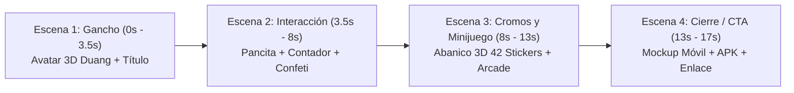

# Brief de Producción y Guía Técnica: Vídeo Promocional de Nailong (HyperFrames)

> **Documento de Contexto y Arranque para la Nueva Sesión:**
> Este documento contiene todas las directrices, storyboard, especificaciones técnicas y recursos necesarios para que el agente de IA (en Antigravity o Claude Code) construya y renderice el vídeo promocional de **El Mundo Mágico de Nailong** utilizando el framework **HyperFrames**.

---

## 1. Ficha Técnica del Vídeo

* **Producto:** [El Mundo Mágico de Nailong (奶龙)](../index.html) (Web interactiva PWA y app APK).
* **Tipo de Vídeo:** **Opción A — Tráiler Viral de Lanzamiento (Product Launch Video)**.
* **Destino:** TikTok, Instagram Reels, YouTube Shorts (Formato vertical).
* **Resolución:** `1080 x 1920` píxeles (aspect ratio 9:16).
* **Duración Total:** **17 segundos** (510 fotogramas a 30 FPS).
* **Framework:** **HyperFrames** (`HTML5 + CSS3 + GSAP 3`).
* **Estilo Visual:** *Claymorphism* blandito, colores cálidos, físicas elásticas (*Duang*), tarjetas 3D y confeti a 60 FPS.

---

## 2. Storyboard Detallado (Escena por Escena)



### 🟡 Escena 1: El Gancho Viral (0.0s – 3.5s | 3.5 segundos)
* **Objetivo:** Atrapar la mirada en los primeros 2 segundos de scroll en redes.
* **Visual:** Fondo amarillo cálido con nubes sutiles flotando. Desde el centro aparece el avatar 3D sonriente (`../Stickers Nailong/sticker_2.webp`) creciendo con un rebote elástico gigante (*Duang*).
* **Tipografía Cinética:**
  - *«¿Conoces al dragón más tierno y viral de internet?»*
  - Badge flotante animado: `⭐ 100% Interactivo`.
* **Animación GSAP:** `gsap.from("#avatar", { scale: 0, rotation: -15, ease: "back.out(2)", duration: 1 })`.

### 🟠 Escena 2: La Pancita y el Modo Fiesta (3.5s – 8.0s | 4.5 segundos)
* **Objetivo:** Demostrar que no es una web estática, sino un juguete interactivo.
* **Visual:** Aparece un mockup estilizado de pantalla de smartphone.
  - Se simula un cursor táctil que pulsa rítmicamente la pancita de Nailong.
  - En cada toque, el personaje se deforma con efecto gelatina (`scaleY: 0.85, scaleX: 1.15`) y el contador numérico de clics sube a gran velocidad (`+1`, `+2`, `+3` flotando).
  - En el segundo 6.0, se pulsa el botón de **Modo Fiesta**: estallido de confeti y emojis flotantes que llenan la pantalla vertical.

### 🟡 Escena 3: Los 42 Cromos y el Minijuego (8.0s – 13.0s | 5.0 segundos)
* **Objetivo:** Enseñar el contenido coleccionable y la jugabilidad.
* **Visual:**
  - Transición rápida: 6 cartas polaroid de cromos auténticos (`sticker_1.webp`, `sticker_5.webp`, `sticker_10.webp`, `sticker_25.webp`, etc.) entran volando desde diferentes ángulos y rotan en 3D (`preserve-3d`), desplegándose en abanico circular.
  - Texto central: *«¡42 cromos auténticos para coleccionar!»*.
  - En el segundo 10.5, el abanico se aparta y muestra la pantalla arcade del minijuego *«¡La Gran Comilona!»*, con la cesta moviéndose rápidamente atrapando fruta y evitando bombas.

### 🟠 Escena 4: Llamada a la Acción (CTA) y Descarga (13.0s – 17.0s | 4.0 segundos)
* **Objetivo:** Convertir al espectador en usuario/jugador.
* **Visual:**
  - Mockup completo de la app con el logo oficial y Nailong guiñando un ojo.
  - Badges interactivos con pulsación suave:
    - 🌐 `alvarolofra.github.io/Nailong/`
    - 📲 `Descarga el APK (StickersNailong.apk)`
    - ⚡ `100% Gratis y Sin Anuncios`
  - Botón final estilo Claymorphism con brillo animado: *«¡JUEGA AHORA!»*.

---

## 3. Paleta de Colores y Recursos del Proyecto

* **Colores de la App (CSS Tokens):**
  - Fondo Amarillo: `#FFF4BD` / `#FFE66D`
  - Acento Naranja: `#FF8A00` / `#FF6B00`
  - Pancita / Crema: `#FFFBEA`
  - Sombras Claymorphism: `0 12px 28px rgba(255, 138, 0, 0.25)` y `inset 0 4px 8px rgba(255,255,255,0.8)`
* **Assets Disponibles en la Raíz:**
  - Stickers WebP auténticos: `../Stickers Nailong/sticker_1.webp` a `sticker_42.webp`
  - Foto del creador: `../creador_nailong.webp`
  - APK del proyecto: `../StickersNailong.apk`
  - Favicon / Logo: `../Stickers Nailong/sticker_2.webp`
* **Tipografía Recomendada:**
  - Títulos: `system-ui, -apple-system, 'Segoe UI', Roboto, sans-serif` con `font-weight: 800` o `Poppins/Fredoka/Luckiest Guy` (disponibles en Google Fonts con `@import`).

---

## 4. Contrato Técnico de HyperFrames

Para que HyperFrames compile el vídeo de forma determinista y sin fallos, el archivo principal [`index.html`](index.html) de esta carpeta debe cumplir estas reglas:

1. **Estructura del Stage Raíz:**
   ```html
   <div id="stage" 
        data-composition-id="nailong-promo" 
        data-width="1080" 
        data-height="1920" 
        data-start="0" 
        data-duration="17" 
        data-fps="30">
        <!-- Sub-composiciones o escenas modulares -->
   </div>
   ```

2. **Sub-composiciones Modulares por Escena:**
   Cada escena puede residir en un archivo separado en `compositions/` (ej. `compositions/scene1_hook.html`, `compositions/scene2_showcase.html`) o directamente dentro del `stage` con atributos de pista:
   ```html
   <div class="clip" data-start="0" data-duration="3.5" data-track-index="0">...</div>
   <div class="clip" data-start="3.5" data-duration="4.5" data-track-index="0">...</div>
   ```

3. **Timelines de GSAP (Pausadas y Registradas):**
   ```javascript
   const tl = gsap.timeline({ paused: true });
   // Añadir tweens en segundos (tiempo local de la escena)...
   window.__timelines = window.__timelines || {};
   window.__timelines["nailong-promo"] = tl;
   ```

4. **Reglas de Determinismo Obligatorias:**
   - 🚫 Prohibido usar `Math.random()` durante la animación (usa un generador pseudoaleatorio con semilla fija si necesitas aleatoriedad para el confeti).
   - 🚫 Prohibido usar `setTimeout`, `setInterval` o `requestAnimationFrame` para animar (toda animación viaja por la timeline de GSAP).

---

## 5. Skills y Herramientas Disponibles en el Entorno

El entorno ya está 100% preparado con las siguientes herramientas instaladas:

1. **Skills Oficiales de HyperFrames:**
   - Ubicación global en Antigravity: `C:\Users\Administrator\.gemini\config\skills\hyperframes` (y `hyperframes-core`, `hyperframes-animation`, `product-launch-video`, etc.).
   - Ubicación en Biblioteca Central: `C:\Users\Administrator\Documents\Claude Code\Documentos, Herramientas e Información General\Skills\Hyperframes`.
2. **Servidor MCP de HyperFrames Desktop:**
   - La aplicación HyperFrames de escritorio está conectada en tiempo real.
   - Herramientas activas: `preview.frame` (para inspeccionar fotogramas PNG), `project.open`, `render.start`.
3. **Comandos de Consola (CLI):**
   - Previsualizar en vivo en el navegador: `hyperframes preview` (o `npx hyperframes preview`).
   - Validar sintaxis y layout: `hyperframes lint` y `hyperframes check`.
   - Renderizar el vídeo final MP4: `hyperframes render`.

---

## 6. Pasos Inmediatos para la Nueva Sesión

Al abrir la nueva sesión en esta carpeta:
1. Leer este archivo: `BRIEF_Y_GUIA_PRODUCCION.md`.
2. Crear el archivo `index.html` del vídeo implementando la Escena 1 y la Escena 2 con los estilos claymorphism y los stickers de `../Stickers Nailong/`.
3. Ejecutar `hyperframes preview` para abrir la ventana de previsualización en el navegador y verificar la animación.
4. Completar las Escenas 3 y 4.
5. Renderizar a `nailong_promo_final.mp4` con `hyperframes render`.
